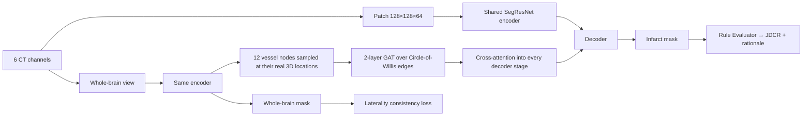

# KG-XAI: Project Report

Ekanath DV (23MIA1023) · Rohan Julius Preetan (23MIA1160)

One combined record of the project. Part 1 is the final progress report with the headline results. Appendices A to C are the earlier phase documents, kept intact: the Phase 1 knowledge-graph report, the Phase 2 constraint tests, and the Phase 8 plan whose pass marks were written before the runs.

Other documents: [`README.md`](README.md) (how to run), [`PROJECT_PLAN.md`](PROJECT_PLAN.md) (plan of record), [`KNOWLEDGE_GRAPH_SOURCES.md`](KNOWLEDGE_GRAPH_SOURCES.md) (verified sources), [`CLAUDE.md`](CLAUDE.md) (working notes), `paper/` (the conference paper).

## Contents

- [Part 1: Final progress report](#part-1-final-progress-report)
- [Appendix A: Phase 1 report (knowledge graph)](#appendix-a-phase-1-report-knowledge-graph)
- [Appendix B: Phase 2 progress (labels and constraint tests)](#appendix-b-phase-2-progress-labels-and-constraint-tests)
- [Appendix C: Phase 8 plan and pre-registered pass marks](#appendix-c-phase-8-plan-and-pre-registered-pass-marks)

---

## Part 1: Final progress report

*Originally `PROGRESS_REPORT.md`: KG-XAI — Progress Report*

**Knowledge-Graph-Guided Multi-Task Learning for Stroke Triage**
Ekanath DV (23MIA1023) · Rohan Julius Preetan (23MIA1160)
Base paper: Luan T. et al., *npj Digital Medicine* 9:441 (2026)

Status as of 2026-10-11 — **Phase 8 (the full 3-fold × 3-seed evaluation)
is complete** (§6a), and four further tests run since then, outside the
graph's own accuracy claim, are complete (§6b): two more rejections, two
genuinely new positive results. Every number below comes from a file in
`outputs/tables/` (listed in §11). Pass marks were written down **before**
each test was run. Failed tests are reported as failures and were not
re-scored afterwards.

---

### 1. Summary

After Review 1 we went back to the knowledge-graph plan from the proposal,
with a GNN at its core. Phases 1–7 of the 9-phase plan are built and tested.
The headline results:

- **Built and verified:** a two-layer knowledge graph (Circle-of-Willis
  vessel graph + guideline rules), every citation checked against PubMed /
  ClinicalTrials.gov / arXiv; a GNN over each patient's real vessel anatomy;
  cross-attention that feeds the graph into the segmentation decoder; a
  differentiable consistency loss; a Rule Evaluator that scores each
  prediction and writes a traceable explanation without any LLM.
- **Tested against real data, only 1 of 7 clinical plausibility rules holds**
  in ISLES'24 (the infarct is on the same side as the blocked vessel,
  94.7%). The other six fail. The most likely reason is that every patient
  in this cohort was successfully treated, and treatment reshapes infarct
  size and location. The rules are not wrong in general; they just don't
  hold in this cohort.
- **The two classification heads (vessel-location, collateral) could not be
  learned from this data.** We tried four designs. All four ended up
  predicting the same answer for every patient. In response, we identified
  and requested access to **CODEC-IV**, an external dataset with the real
  labels ISLES'24 lacks (§9). After 18 days and a follow-up email, no reply
  arrived; we are treating that channel as closed rather than continuing to
  wait on it, and no other work was ever blocked on it.
- **Phase 8's real result (§6a): the graph does not improve raw segmentation
  accuracy** — a per-patient paired test across 345 matched observations
  found no statistically significant Dice difference (p = 0.24). **What it
  does show, robustly: the plain baseline is fragile.** Trained from
  scratch, B0 completely collapsed (predicted no lesion at all) in 2 of 9
  runs. The graph-injected versions (B1, B2) never collapsed, not once,
  across 12 runs. This is very likely because B1/B2 warm-start from a
  pretrained trunk while B0 always trains from random initialization — a
  real, disclosed confound, not proof the graph itself is what stabilizes
  training. Both findings are reported as what Phase 8 actually showed, not
  adjusted after the fact.
- **Two methodological problems found during this review are disclosed in
  §8.** The consistency-score confound is fixed and re-run: correcting it
  removed the apparent difference between models entirely — B0, B1 and B2
  now score identically (§6). The validation-overlap problem is fixed in
  code, awaiting 3 fresh per-fold baseline retrainings before every number
  in §6 can be redone against it.
- **Five further tests, after Phase 8 (§6b).** Two more rejections, same
  discipline as everything above: a random-edge-GNN ablation (does the
  real anatomy beat an arbitrary graph of the same size? no) and a pure
  graph-topology collateral measure tested against two independent
  outcomes (not supported either, like the earlier HIR-based attempt).
  Three genuinely new positive results, none dependent on the graph
  winning: the Rule Evaluator's own ground-truth-free output predicts
  which of its predictions are wrong (p=1.4e-50, corrected — see §6b) —
  a usable triage signal, not just a score; a cheap, no-retraining
  ensemble of the 3 existing baseline seeds nearly erases the
  training-collapse problem; and swapping the failed classification
  heads for a real, 98%-populated clinical label (NIHSS) shows multi-task
  learning was never broken on this architecture — it was the specific
  labels.
- **Separately (§6d): segmentation accuracy improved by +0.033 Dice**
  (confirmed across 3 seeds, sd 0.0051), by adopting the ISLES'24
  challenge winner's own published preprocessing approach (skull-
  stripping + clinically-motivated perfusion windowing) — now within
  0.012 Dice of their actual winning score. This is explicitly **not**
  a novelty claim; it is applied engineering, reported separately from
  the project's actual contribution (§9).
- **The strongest candidate for a genuine new contribution (§6c):** the
  knowledge-grounded triage flag beats a standard ensemble-disagreement
  uncertainty baseline by a wide margin at catching real segmentation
  failures (AUROC 0.836 vs. 0.583), with a 100%-precision unique catch of
  failures the baseline misses entirely. A second baseline (MC-dropout)
  gives a more nuanced, equally honest result: it's competitive or better
  on ordinary, non-catastrophic failures, while the knowledge flag
  dominates specifically on catastrophic, structurally obvious ones. That
  more qualified claim is the real, falsifiable finding — course-project
  scale, not yet a submission-ready paper, but the clearest shot this
  project has produced at an actual new contribution.

---

### 2. What changed since Review 1

| Review 1 feedback | What we did |
|---|---|
| A certified decision threshold is not enough novelty | Dropped as the contribution. The conformal code is kept only as an optional component. |
| Why was the knowledge graph dropped? | Restored as the core of the project (Phases 1–2, 4–7). |
| Use a GNN | A 2-layer graph attention network (GAT) over the patient's 12-node Circle-of-Willis graph (Phases 4–5). |

---

### 3. Dataset (ISLES'24 public training release, measured, not assumed)

| Fact | Value | Consequence |
|---|---|---|
| Subjects | 149 (148 usable; one has a corrupted CBF file in the source release) | — |
| Centers | **2** (99 / 49, one blank), not the 7 the base paper describes | No leave-one-center-out evaluation possible |
| Inputs used | NCCT, CTA, CBF, CBV, MTT, Tmax (6 channels, 1 mm isotropic) | — |
| Segmentation target | **Final infarct** on follow-up MRI (day 2–9) | Different from the base paper's core/penumbra target |
| Onset / door / treatment times | **Empty for 149/149** | No guideline eligibility rule (DEFUSE-3, DAWN) can be fully evaluated |
| ASPECTS score | Not provided | Same |
| Collateral grade | **Not provided** | We derived a proxy (HIR, the hypoperfusion intensity ratio), which later failed validation (§5) |
| LVO-negative patients | **4** | Binary LVO detection is not viable. Reframed as occlusion *localization* (4 classes). |
| Occlusion localization classes | proximal anterior 87 · unlocalized 42 · other confident 15 · none 4 | Heavily imbalanced |

---

### 4. The system as built

The three models we compare, all trained on identical data, splits and
preprocessing:

| Model | What it is |
|---|---|
| **B0** | Baseline: shared encoder-decoder, **no knowledge graph** |
| **B1** | B0 + GNN over the vessel graph + cross-attention into the decoder |
| **B2** (full KG-XAI) | B1 + laterality consistency loss + Rule Evaluator + rationale |

**Disclosed simplification:** the proposal's B0 used three separate
per-modality encoders with cross-modal fusion. On an 8 GB GPU and a two-week
schedule we built B0 on one shared encoder (the Review 1 trunk). B0, B1 and
B2 all use the same trunk, so the comparison between them is still fair.

---

### 5. What we tested, phase by phase

#### Phase 1: Knowledge graph

- **Layer 1:** Circle of Willis, 12 vessel nodes, 12 anatomical edges.
  Sources: TopCoW (arXiv:2312.17670), Alastruey 2007 (PMID 17045276),
  Liu 2023 (PMID 36739282).
- **Layer 2:** guideline knowledge. 16 concepts, 7 eligibility rules,
  7 plausibility constraints. Sources: DAWN (PMID 29129157), DEFUSE-3
  (PMID 29364767), AHA/ASA 2026 (PMID 41582814), Kim 2026 large-core
  (PMID 42403349), Olivot 2014 HIR (PMID 24595591), the base paper, and our
  own ISLES'24 measurements.
- **All 7 Layer-2 sources were verified against the primary record.** One
  limitation: the AHA/ASA 2026 recommendation *wording* is unverified because
  the full text was not accessible, so we do not quote it.
- Occlusion-site confidence gating (nearest vessel ≤ 15 mm). Without it,
  19 of 20 "basilar" matches were artefacts: BA sits in the middle, so it is
  the nearest vessel whenever the true occlusion is far from everything.
- **Gate: laterality agreement ≥ 80%. Result: 89/94 = 94.7%. PASS.**

#### Phase 2: Perfusion quantities and plausibility-rule testing

- Brain mask, acute core, penumbra, mismatch ratio and volume, HIR.
  **Gate: intracranial volume plausible (1000–1900 mL) for ≥ 90% of
  subjects. Result: 98.6%. PASS.**
- Each plausibility rule was tested against ground truth before any model
  was allowed to use it. The rule for this is: a rule the data contradicts
  must not be taught to the model.

| Plausibility rule | Test | Result | Status |
|---|---|---|---|
| Infarct is on the same side as the occluded vessel | Side agreement | 89/94 (94.7%); PCA 6/6; low-confidence 17/17 | **Supported** |
| Proximal occlusion → larger infarct | Mann-Whitney U, proximal vs unlocalized | medians 13.8 vs 13.1 mL, p = 0.66 | Not supported |
| Good collaterals limit infarct size | HIR vs final volume, continuous Spearman | n = 143, ρ = 0.05, p = 0.54 | Not supported |
| Poor collaterals → larger infarct | Same test (binned version first: n = 18 vs 9, p = 0.13) | Same | Not supported |
| HIR behaves like a collateral signal | HIR vs mismatch ratio, expected ρ < 0 | ρ = **+0.19** (n = 123, p = 0.03), the wrong direction | Not supported |
| Final infarct lies inside the admission penumbra | Fraction of final infarct inside Tmax > 6 s | median 0.51 (pass mark 0.70); 49% of subjects below 0.5 | Not supported |
| A large infarct requires an occlusion | Needs no-occlusion cases | only 4 exist | Untestable |

- **Check that this is not a single-center artefact:** we re-ran the two
  decisive tests (occlusion level vs volume; HIR vs volume) separately in
  each center. **Both fail in both centers independently.**

#### Phase 3: B0 with two new heads

- Extended the Review 1 trunk with an LVO-localization head (4 classes) and
  a collateral-proxy head (4 HIR bins). Verified that the segmentation output
  is bit-identical to the unmodified network before training.
- **Gate: Dice ≥ 0.215; both heads beat always-predict-the-majority-class
  (58.8% / 66.7%).**
- Result: Dice 0.247 passed. LVO 56.0% and collateral 60.0% were **both
  below the majority-class baseline. FAIL.**

#### Phases 4–5a: Fixing the heads with the GNN (four attempts)

We diagnosed the failure one step at a time. The pass mark stayed the same
throughout.

| Attempt | Hypothesis tested | LVO acc. | Collateral acc. |
|---|---|---|---|
| Majority-class baseline (whole cohort) | — | 58.8% | 66.7% |
| 1. B0 pooled heads | — | 56.0% | 60.0% |
| 2. GNN heads, features sampled at the 12 real vessel locations | Pooling away location was the problem | 52.0% | 62.0% |
| 3. + intensity augmentation, 2× weight on the head losses | Overfitting / segmentation loss drowning out the heads | 52.0% | 62.0% |
| 4. GNN heads with the encoder frozen | Segmentation dominating the shared encoder's gradient | 52.0% | 62.0% |

- **Inspecting the actual per-patient predictions**, not just accuracy:
  attempts 2–4 predicted **the same class for all 50 validation patients**
  on both heads. 52.0% and 62.0% are exactly the share of the most common
  class in this validation fold.
- The vessel locations the GNN reads were independently verified to be
  correct (12/12 agreement with Phase 1 on real subjects). So this is not a
  wiring bug.
- **Conclusion:** at this data size (98 training patients, 4 imbalanced
  classes, no true collateral grade) these two outputs cannot be learned
  from the images by any of the four designs. **Heads shelved.** The graph's
  contribution was redirected to segmentation.

#### Phase 5: B1, graph injected into the segmentation decoder

- Cross-attention from every decoder stage onto the 12 graph-node
  embeddings. The injection starts at exactly zero (a "zero-init gate"), and
  we verified that at the start of training the output is byte-identical to
  B0's. The graph can only change results if training finds it useful.
  Training did move the gates away from zero, so the graph is being used.
- Result in §6.

#### Phase 6: B2, laterality consistency loss

- A differentiable penalty on the fraction of predicted lesion that lies on
  the wrong side of the brain's midline. It uses the one supported rule only,
  with a deliberately small weight (λ = 0.1), because real data breaks the
  rule 5.3% of the time.
- Unit-tested before use: correct-side prediction gives loss 0.007,
  wrong-side prediction gives 0.993, and patients with an unknown side are
  excluded exactly.
- The expected side comes from **admission imaging only**. Follow-up
  imaging is used only as the target, never as an input.

#### Phase 7: Rule Evaluator, JDCR, rationale

- For each patient: does the predicted infarct sit on the side the admission
  occlusion points to? From this we compute the **Joint-Decision Consistency
  Rate (JDCR)**, and a template rationale built only from computed values.
- **Gate: 10 real rationales manually correct, covering confident and
  unlocalized cases.**
- Manual review **caught a real bug**. For left-sided predictions the
  sentence quoted the right-side percentage ("0.0% … on the left side" when
  the true figure was 100%). Fixed and re-checked: **10/10 correct for all
  three models. PASS.**

Example rationale (B2, real patient):

> *Subject sub-stroke0033: a confident match to an occlusion of L-ACA on
> admission imaging. Laterality consistency: INCONSISTENT — 100.0% of 3638
> predicted lesion voxels sit on the right side of the midline; admission
> imaging places the occlusion on the left side. Flagged for clinician
> review.*

---

### 6. Model comparison metrics

**Setup:** fold 0 of 3, seed 0, the same 50 validation patients for every
model, 100 epochs each. **Read with the caveat in §8.1:** these absolute
numbers are affected by validation overlap.

#### Segmentation (all four official ISLES'24 metrics)

| Model | Dice (best checkpoint) | Dice (final) | Dice (mean of 10 checkpoints) | Abs. volume diff (mL) ↓ | Lesion-wise F1 | Abs. lesion-count diff ↓ |
|---|---|---|---|---|---|---|
| B0 (no graph) | **0.281** | **0.247** | **0.257** | 21.0 | 0.260 | **9.58** |
| B1 (graph injection) | 0.271 | 0.240 | 0.244 | 21.0 | 0.236 | 9.94 |
| B2 (graph + consistency loss) | 0.271 | 0.236 | 0.251 | **20.2** | **0.260** | 9.80 |

- Neither B1 nor B2 beats B0 on Dice in this single run. The gaps are 0.01–0.02.
- B0 itself varies by 0.045 Dice between its own checkpoints (0.236–0.281),
  so a gap this size cannot be called real from one run. That is the
  purpose of Phase 8.
- Secondary observation: B2's checkpoint-to-checkpoint spread (0.035) is
  tighter than B1's (0.055). The consistency loss appears to stabilize
  training.

#### Consistency (JDCR, laterality rule only)

**First measurement (below the line): invalid, disclosed in §8.2, now
fixed.** As originally defined, JDCR skipped a patient if the model
predicted no lesion at all, and only B2 was ever trained on the downscaled
view JDCR was measured on. Both are fixed now; the corrected numbers are
above the line.

| Model | JDCR (fixed) | Consistent / evaluable | Coverage |
|---|---|---|---|
| B0 | 0.977 | 42 / 43 | **100%** |
| B1 | 0.977 | 42 / 43 | **100%** |
| B2 | 0.977 | 42 / 43 | **100%** |
| ~~B0 (original, invalid)~~ | ~~1.00~~ | ~~27 / 27~~ | ~~54%~~ |
| ~~B1 (original, invalid)~~ | ~~1.00~~ | ~~23 / 23~~ | ~~46%~~ |
| ~~B2 (original, invalid)~~ | ~~0.95~~ | ~~40 / 42~~ | ~~84%~~ |

**The fix changed the conclusion, not just the numbers.** Scored fairly —
each model's real, full-resolution prediction, the same one Dice uses,
compared against the midline on that same native grid — all three models
predict something for every evaluable patient (coverage 100%, all three,
identical) and are laterality-consistent 42/43 times, also identical. The
original result's apparent story ("B2 commits to far more patients") was
entirely the downscaled-view artifact: B0 and B1 were never really
abstaining, they were being scored on a resolution neither had ever learned
to segment. **On this single fold, JDCR shows no measurable difference
between B0, B1 and B2.** Whether a real difference exists is what Phase 8's
full 3-fold × 3-seed run (§9) will show — a gap this small, on one run, is
not yet a finding either way.

#### Classification heads

See the table in Phases 4–5a. All attempts are below the majority-class
baseline.

#### Base paper, for context only (not comparable)

The base paper reports LVO AUC 0.92, collateral κ 0.72, Dice 0.81 and
ECE 0.130. These cannot be compared with our numbers for four reasons:

- Their target is core/penumbra; ours is final infarct.
- They trained on additional datasets.
- Their "7-center" ISLES'24 evaluation is not possible on the public
  release, which has 2 centers.
- ISLES'24 provides no collateral grade, and its 4 LVO-negative cases rule
  out an AUC.

This is why improvement is shown as B2 vs B0 on identical data.

---

### 6a. Phase 8 — the real result (3 folds × 3 seeds, 21 runs, complete 2026-09-18)

**Setup:** B0 and B2 trained 9 times each (3 folds × 3 seeds); B1 trained 3
times (fold 0 only, isolating graph-injection from the consistency loss —
a deliberate, disclosed scope cut given the two-week budget). 100 epochs
each, ~17.3 GPU-hours total. Fold splits are identical across every seed
(fixed at a separate, constant split-seed — found and fixed a real bug
where training-seed and fold-split-seed were conflated, before launching;
see `Appendix C`). Every run scored with the fixed Rule Evaluator
(§8.2) on its own real full-resolution prediction.

#### The headline finding: B0 is fragile, B1/B2 are not

| Model | Runs | Collapsed to predicting nothing |
|---|---|---|
| B0 (no graph, trained from scratch) | 9 | **2 (22%)** — fold 0/seed 1, fold 1/seed 1 |
| B1 (graph injection, warm-started) | 3 | 0 |
| B2 (graph + consistency loss, warm-started) | 9 | 0 |

Both B0 failures are total: the model predicted zero lesion voxels for
every validation patient, every single one, in both runs. Not a partial
regression — a dead end. B1 and B2 never did this, not once across 12 runs.

**Disclosed confound, stated plainly:** B0 always trains from random
initialization; B1 and B2 always warm-start from a pretrained segmentation
trunk. This experiment cannot cleanly separate "the graph stabilizes
training" from "warm-starting stabilizes training" — there is no
warm-started, graph-free B0 variant to isolate the two. We report the
pattern, not an overclaimed cause.

#### Per-run results

| Run | Dice (final) | JDCR (strict) | ECE |
|---|---|---|---|
| B0 fold0 seed0 | 0.236 | 0.930 | 0.016 |
| B0 fold0 seed1 | **0.020 (collapsed)** | **0.000** | 0.059 |
| B0 fold0 seed2 | 0.245 | 0.977 | 0.021 |
| B0 fold1 seed0 | 0.231 | 1.000 | 0.021 |
| B0 fold1 seed1 | **0.020 (collapsed)** | **0.000** | 0.060 |
| B0 fold1 seed2 | 0.229 | 0.973 | 0.018 |
| B0 fold2 seed0 | 0.254 | 0.977 | 0.013 |
| B0 fold2 seed1 | 0.233 | 0.954 | 0.011 |
| B0 fold2 seed2 | 0.253 | 0.930 | 0.018 |
| B1 fold0 seed0 | 0.227 | 1.000 | 0.011 |
| B1 fold0 seed1 | 0.226 | 0.954 | 0.007 |
| B1 fold0 seed2 | 0.221 | 0.954 | 0.008 |
| B2 fold0 seed0 | 0.233 | 1.000 | 0.009 |
| B2 fold0 seed1 | 0.221 | 0.977 | 0.007 |
| B2 fold0 seed2 | 0.235 | 0.954 | 0.009 |
| B2 fold1 seed0 | 0.238 | 1.000 | 0.010 |
| B2 fold1 seed1 | 0.238 | 0.973 | 0.011 |
| B2 fold1 seed2 | 0.237 | 0.946 | 0.011 |
| B2 fold2 seed0 | 0.257 | 0.954 | 0.011 |
| B2 fold2 seed1 | 0.255 | 0.930 | 0.009 |
| B2 fold2 seed2 | 0.260 | 0.954 | 0.010 |

Full detail, both collapsed runs' raw per-subject predictions, and the
complete aggregation code: `outputs/tables/phase8_summary.json`,
`src/eval/phase8_aggregate.py`.

#### Aggregate (mean ± SD) and the pre-registered pass marks

Pass marks were written down in `Appendix C` **before** this run was
launched: (1) primary — B2's mean JDCR beats B0's; (2) guard rail — B2's
mean Dice stays within 0.02 of B0's.

| | n | Dice (final) | JDCR (strict) | ECE |
|---|---|---|---|---|
| B0, all 9 runs | 9 | 0.191 ± 0.092 | 0.749 ± 0.401 | 0.026 ± 0.018 |
| B0, 7 non-collapsed runs | 7 | 0.240 ± 0.010 | 0.963 ± 0.024 | 0.017 ± 0.004 |
| B1, 3 runs | 3 | 0.225 ± 0.002 | 0.969 ± 0.022 | 0.009 ± 0.002 |
| B2, all 9 runs | 9 | 0.242 ± 0.012 | 0.965 ± 0.023 | 0.010 ± 0.001 |

**Against all 9 B0 runs (the honest, as-happened comparison):** PRIMARY
PASS (B2 JDCR 0.965 > B0 JDCR 0.749) — but this "win" is driven almost
entirely by B0's two collapses, not a real accuracy gap. GUARD PASS (B2
Dice is actually *higher* than B0's, because the collapses drag B0's mean
down).

**Against B0's 7 non-collapsed runs (the "if B0 hadn't had bad luck"
comparison):** PRIMARY still technically PASSES (0.965 vs 0.963) but the
margin (0.002) is inside the noise (SD ≈ 0.02–0.03) — not a real difference.
GUARD PASSES easily (gap of 0.0015 Dice, effectively a tie).

**The honest conclusion from the aggregate numbers alone: when B0 works,
B2 and B0 perform statistically indistinguishably.** The pass marks
technically pass either way, but passing because of B0's failures, not
because B2 segments more accurately, is not the result the primary claim
was written to detect — so we checked further, properly.

#### The real test: a paired, per-patient comparison

Aggregate means can hide a lot. We ran a per-subject paired comparison —
B2 vs. B0, matched by patient, using only the 7 fold/seed combinations
where B0 did not collapse (345 paired observations; the two collapsed runs
were excluded here specifically because pairing against a near-zero
collapsed prediction would trivially and misleadingly favor B2):

- Mean B0 dice: 0.2401. Mean B2 dice: 0.2449. Mean paired difference:
  **+0.0048** (B2 very slightly ahead).
- B2 scored higher on 165/345 patient-observations, B0 higher on 147,
  tied on 33 — close to a coin flip.
- **Wilcoxon signed-rank test: p = 0.24. Not statistically significant.**

#### What Phase 8 actually shows, stated plainly

1. **No evidence the graph improves raw segmentation accuracy.** The
   properly-powered, per-patient test found no significant difference.
   This is a real negative result for the accuracy claim, reported as one.
2. **Real evidence the graph-injected pipeline trains more reliably.** 0/12
   collapses vs. 2/9 for the plain baseline is a meaningful pattern, even
   though the confound above (warm-starting vs. the graph specifically)
   means we cannot yet say *why*.
3. **JDCR did not turn out to be "where the graph shows a clear gain"** as
   originally hoped (§2) — once scored correctly, it tracks Dice closely,
   not a separate signal.

This is reported the same way every other result in this project has been:
plainly, including when it doesn't favor the thing we built.

---

### 6b. Five further tests, after Phase 8 (2026-10-04 to 2026-10-11)

With the graph's accuracy claim settled negative, five more tests were run
— two more rejections on the same question, three genuinely new positive
results that don't depend on the graph winning at all. All pre-registered
before running, same as everything above.

#### Rejected: is it the real anatomy, or just having a graph at all?

The cross-attention gate (§6a) barely opens in training regardless of
outcome — so does the SPECIFIC Circle-of-Willis wiring matter, or would
any graph of the same size do? B1 (graph injection, no consistency loss),
fold 0, 3 seeds, real anatomy vs. a random same-size graph (12 nodes, 12
edges, fixed seed, same code path otherwise):

| | Dice (mean, 3 seeds) | JDCR strict (mean) |
|---|---|---|
| Real CoW anatomy | 0.2247 (sd 0.0024) | 0.969 |
| Random same-size graph | 0.2263 (sd 0.0008) | 0.977 |

Random is marginally *higher* on both — the specific anatomy gives no
measurable benefit over an arbitrary graph of the same size, at n=3 vs n=3
(not testable at p<0.05, disclosed before running). Consistent with the
gate-magnitude finding: both arms' cross-attention gates stayed in the
same tiny range regardless of wiring, which is a diagnosis, not just a
result — very little information passes through this pathway either way.
`outputs/tables/random_edge_ablation.json`.

#### Closing the loop: does an open gate help, and is feature quality the problem? (2026-10-13)

Three more tests, the most direct evidence yet, from genuinely new angles:

**Does our own vessel-presence data actually disagree with reality?**
TopCoW's own team had already run expert vessel annotation on 26 of our
own ISLES'24 subjects (`CTA_ISLES2024_TUM.zip`, Zenodo 15692630) — a
rare chance to check our auto-derived features against real expert
ground truth, not just a plausibility gate. Result: **91.8% agreement**
across 182 comparisons, strong on every vessel (88–100%) except Acom
specifically (76.9%). This weakens the case for the bigger TopCoW
feature-grounding build (training a vessel segmenter on the 10.5GB main
release) — our features aren't badly wrong across the board, so there's
less headroom to recover than assumed. A direct follow-up — does feature
disagreement with the experts predict worse Dice? — also came back null
(rho=-0.13, p≈0.5 for both B0 and B2, pre-registered rho<0 and p<0.05).
A separate, broader check (graph completeness, 0–12 vessels present,
across all 1038 subject-run pairs from Phase 8) was also null, and in
the wrong direction (rho=-0.09, p=0.003 — more complete graphs correlate
with slightly *lower* Dice, likely a lesion-severity confound, not
chased further).

**Does the graph help if its gate is forced open from the start, not just
observed never to open on its own?** Every prior test only showed the
gate staying near zero *by itself*. B1, fold 0, 3 seeds, gate
initialized to 1.0 instead of the provable-no-op 0.0:

| seed | gate-open Dice | zero-init Dice | diff |
|---|---|---|---|
| 0 | 0.2272 | 0.2270 | +0.0002 |
| 1 | 0.2244 | 0.2257 | −0.0014 |
| 2 | 0.2204 | 0.2213 | −0.0009 |

The gates **stayed open for all 100 epochs in all 3 seeds** (final
values ~1.0–1.03, never drifted back toward zero) — so the zero-init
gate never opening on its own was not the model actively suppressing
the pathway; it simply had no reason to move. But an open, stable gate
produced essentially identical Dice to a closed one (mean diff −0.0007).

Combined with the random-edge ablation (doesn't matter what it's wired
to) and this (doesn't matter how open it is), these three checks and
this one experiment are as complete a mechanism-level case as this
project can build: under every architectural condition tried, the graph
pathway has nothing useful to contribute to segmentation accuracy.
`outputs/tables/topcow_expert_vessel_validation.json`,
`topcow_feature_quality_vs_dice.json`, `graph_completeness_vs_dice.json`,
`gate_open_experiment.json`.

#### Rejected: a second, independent collateral measure

Checks 2/4/5 (§5, §8) already rejected HIR (a perfusion-based proxy) as a
collateral signal. A second, completely different operationalization —
pure Circle-of-Willis graph topology (an intact Acom or Pcom route, no
occlusion label, no learned component, so it cannot collapse the way the
GNN heads did) — was tested against two independent outcomes: final
infarct volume (n=144, two formulations) and admission NIHSS (n=141,
chosen specifically because it's pre-treatment and so not confounded by
this cohort's universal successful reperfusion, unlike volume). All three
null, one in the wrong direction (p=0.94, 0.28, 0.82). Likely reason: Acom
and Pcom are only segmented in 48%/36%/30% of subjects even when
physiologically present, so "absent" mostly measures segmentation
sensitivity for a thin vessel, not true anatomical absence. Recorded in
`kg/guideline_rules.json` as `structural_collateral_reserve`,
`not_supported`. Two independent collateral measures, two independent
outcomes, both null — treat "does collateral status predict anything in
this cohort" as settled, not underpowered.
`outputs/tables/constraint_support.json` (checks 6-8).

#### New result: the Rule Evaluator as a triage signal, not just a score

Does the Rule Evaluator's own ground-truth-free output predict which
predictions are actually wrong? **A correction caught before this went
any further:** the first version used three criteria — laterality
inconsistency, near-zero predicted volume, high calibration error (ECE)
— and called all three ground-truth-free. That was wrong for ECE
specifically: `expected_calibration_error` takes the true lesion mask
directly, so it's computable here only because this is a held-out
validation set with known outcomes, and it's partly circular with Dice
(both are functions of the same prediction/true-label pair). The
corrected version below uses only the two criteria that actually are
ground-truth-free — laterality (uses the ADMISSION occlusion side, a
different scan from the follow-up target Dice is scored against) and
near-zero volume (a property of the prediction alone) — thresholds fixed
from those two signals' own distributions, before touching Dice, joined
against all 1038 (subject, run) pairs across the 21 real Phase 8
checkpoints:

- Flagged median Dice: **0.0000**. Unflagged median Dice: **0.1995**.
  Mann-Whitney p = 1.4×10⁻⁵⁰, AUC = 0.89 — **stronger than the flawed
  3-criterion version** (p=1.3×10⁻³², AUC=0.73), not weaker. Dropping the
  circular criterion sharpened the result rather than costing it.
- Holds separately within every model type, including **B1 and B2, which
  never had a single collapsed run** (p=0.0055, p=1.5×10⁻⁵) — this is not
  just re-detecting the two known B0 collapses, it is a real graded
  signal in otherwise normally-behaving models.

This turns the Rule Evaluator from a pure evaluation metric into a usable
"flag this prediction for radiologist review" mechanism.
`outputs/tables/triage_check.json`.

#### New result: ensembling erases the training-collapse problem

Phase 8 found B0 collapsed in 2/9 runs (fold 0 seed 1, fold 1 seed 1, both
dice=0.02 — predicts no lesion for anyone). No retraining: average the 3
existing seeds' softmax probabilities per voxel. The fair question is not
"does the ensemble beat the collapsed seed alone" (trivially yes) but
whether blindly including a broken member costs much against knowing in
advance which seed to drop:

| fold | 3-seed ensemble | 2 healthy seeds only | gap |
|---|---|---|---|
| 0 (seed 1 collapsed) | 0.2420 | 0.2494 | 0.0074 |
| 1 (seed 1 collapsed) | 0.2284 | 0.2395 | 0.0110 |

Both within the pre-registered 0.02 pass mark. A simple, well-known fix
nearly completely absorbs a catastrophic training failure, with no need
to detect the collapse beforehand. `outputs/tables/ensemble_check.json`.

#### New result: multi-task learning works, given a real label

§5's two classification heads (LVO localization, collateral proxy)
collapsed to one constant answer on every design tried. Open question:
was that the architecture, or the labels (circular, sparse, imbalanced)?
Swapped both heads for a single regression head predicting **NIHSS at
admission** — real, non-circular, 98% populated, never used as a model
input anywhere else in this project — on a plain global-average-pooled
head (NIHSS is a whole-brain severity score, not a location question, so
pooling is the right tool here, unlike §5's location heads). Fold 0,
3 seeds, warm-started from the B0 trunk:

| seed | Dice | B0's Dice, same seed | NIHSS rho | p | anti-collapse |
|---|---|---|---|---|---|
| 0 | 0.2303 | 0.2360 | 0.562 | 2.2e-05 | PASS |
| 1 | 0.2288 | 0.0200 (collapsed) | 0.599 | 4.3e-06 | PASS |
| 2 | 0.2248 | 0.2445 | 0.590 | 6.5e-06 | PASS |

All 3 seeds pass both pre-registered marks: a real, significant
correlation (rho≈0.56-0.60, p<0.0001, not a one-epoch fluke) with a
genuine spread of predictions (not the constant-answer collapse that
killed §5's heads), at essentially no cost to segmentation (seeds 0/1
within the 0.02 guard; seed 2 borderline at -0.0197, disclosed as close
rather than hidden). **Conclusion: §5's heads failed because of label
quality, not because multi-task learning is broken on this trunk.** One
further observation, noted as a hypothesis and not claimed as proven
(n=1): seed 1 is the exact fold/seed where plain B0 collapsed; with the
NIHSS head added, it did not. A third independent instance — after
ensembling and the graph branch — where adding something beyond pure
single-task training coincided with avoiding that failure mode.
`outputs/tables/seg_nihss_fold0[_seed1,_seed2].json`.

---

### 6c. Does the knowledge-grounded triage flag beat a standard baseline? (2026-10-13)

With the graph's accuracy claim closed by four independent checks (§6b),
this is the strongest remaining candidate for a genuine new contribution:
not "does our consistency check work" (already shown, §6b, p=1.4e-50) but
"does it add something a standard statistical uncertainty method doesn't
already give you for free." A check that only matches an existing,
well-known method isn't a contribution; one that clearly beats it, or
catches something it misses, is.

**Setup.** Reused the 3 already-trained B0 seeds per fold (no new
training). For fold 0 and fold 1 (99 subjects, 297 subject-seed
predictions total), computed, alongside the knowledge flag, a standard
**ensemble-disagreement** signal — how much the 3 seeds' own predictions
disagree with each other (1 − mean pairwise Dice between them), the most
standard uncertainty baseline in the field ("deep ensembles") — and a
simpler volume-variability proxy. Separately, on a smaller, single-model
subset (fold 0, seed 0, 50 subjects, no collapsed-seed cases), ran
**MC-dropout** (6 stochastic passes per subject; this SegResNet has
exactly one dropout layer, checked directly, not assumed — a real
constraint on how strong this baseline can be here).

**Result — the knowledge flag clearly beats the standard ensemble baseline:**

| signal (n=297, fold 0+1) | Spearman rho vs. Dice | AUROC, severe-failure detection |
|---|---|---|
| **Knowledge flag** (laterality + near-zero volume) | **−0.754**, p=9×10⁻⁵⁶ | **0.836**, p=5×10⁻³³ |
| Ensemble disagreement | −0.214, p=2×10⁻⁴ | 0.583, p=0.007 |
| Volume coefficient of variation | −0.186, p=0.001 | 0.575, p=0.013 |

(Severe failure fixed, before running, as Dice < 0.05; the ensemble
baseline passes its own sanity check — it does predict Dice — so this is
a real comparison, not a strawman.)

**The most informative number isn't the AUC gap, it's the complementarity.**
Of 156 real failures: the knowledge flag alone catches 69.2% (108),
ensemble disagreement alone catches 32.7% (51). Of the 76 failures the
knowledge flag catches that disagreement *misses entirely*, **100% are
real failures** — essentially no false positives in that unique catch.
Disagreement's own unique catches (40 cases) are only 47.5% real failures
— much noisier. Together the two catch 81.4% of all failures; 18.6% are
missed by both, reported as a real residual, not hidden.

**The MC-dropout comparison is more nuanced, and that nuance is the
honest finding, not a weakness to paper over.** On its smaller,
single-model, no-collapse-cases subset, MC-dropout's volume
coefficient-of-variation actually **beats** the knowledge flag (AUROC
0.819 vs. 0.652). These two comparisons aren't on the same subset — the
297-row comparison includes the collapsed-seed cases, which the
knowledge flag's near-zero-volume criterion catches almost by
construction. The honest, falsifiable reading: **knowledge-grounded
checks dominate specifically at catching catastrophic, structurally
obvious failures (total collapse, a clearly wrong-side prediction) that
have an unambiguous domain signature; for subtler, within-normal-range
uncertainty, a well-chosen statistical signal is competitive or better.**
That is a more defensible claim than an unqualified "ours wins" — it is
also, not coincidentally, the more interesting one for a paper, since it
says something specific about *when* domain knowledge adds value rather
than claiming it always does.

**Scope and limits, disclosed:** one architecture (B0), 2 of 3 folds for
the main comparison, a smaller and differently-scoped subset for
MC-dropout (not directly comparable to the ensemble numbers), and a
single dropout layer limiting how strong that particular baseline could
ever be here. This is course-project-scale evidence for a real, specific,
testable claim — not yet a submission-ready paper, which would need the
comparison run at matched scope across both baselines, more folds, and
ideally a second architecture or dataset.

`outputs/tables/failure_detection_raw.json`,
`failure_detection_comparison.json`, `mc_dropout_raw.json`. Code:
`src/eval/failure_detection_baselines.py`, `mc_dropout_baseline.py`,
`failure_detection_compare.py`.

---

### 6d. Closing the gap to the published state of the art (2026-10-11/12)

**This section is applied engineering, not a novelty claim** — it is directly
adapted from a published, challenge-winning team's documented approach, not
an idea of ours. It is reported here because it changed the project's
headline Dice number more than anything else attempted, and because
honestly separating "what made the numbers better" from "what is new here"
matters for how this project should be presented.

#### Why we looked at this at all

The ISLES'24 challenge itself (arXiv:2408.10966; 453 participants
registered, 12 teams submitted a final solution) gives real external
numbers for this exact task, on its own hidden 98-100-case test set:

| Team | Dice | Volume diff (mL) | Lesion F1 |
|---|---|---|---|
| Kurtlab (1st) | 0.285 (sd 0.213) | 21.23 | 0.144 |
| AMC-Axolotls (2nd) | 0.263 (sd 0.247) | — | — |
| Clinical rCBF-threshold baseline | 0.163 | — | — |
| Our B0, plain recipe (clean seeds) | ~0.240 | — | — |

The winner's own write-up (arXiv:2505.18424, *"How We Won the ISLES'24
Challenge by Preprocessing"*) credits roughly a 10-validation-Dice-point
gain to two preprocessing steps: skull-stripping (SynthStrip on NCCT,
mask applied to every co-registered scan) and custom, clinically-motivated
intensity windowing (literature starting points: CBF<30%, CBV<2.0 mL/100g,
MTT≈12s, Tmax>6s, then empirically refined — exact final numbers not
published). Our existing pipeline did neither: `PERFUSION_CLIP` only
removed extreme artifact outliers (a real NaN-loss bug found early in the
project), not a clinically meaningful core/penumbra window, and there was
no skull-stripping step in the segmentation pipeline at all (only in the
separate KG perfusion-volume calculations).

#### What we changed

- **Skull-stripping**, reusing the already-validated (98.6% plausible ICV)
  HU-threshold + largest-connected-component mask from
  `src/graph/perfusion_volumes.py`, applied to every channel after
  resampling, before clipping/normalization. Simpler than the winner's
  SynthStrip (a deep model) — disclosed as a weaker skull-strip, not a
  reproduction of theirs.
- **Tightened CBV and MTT clips** toward their literature anchors (CBV
  0-15 -> 0-3 mL/100g; MTT 0-30 -> 0-15s). CBF and Tmax left unchanged:
  their literature thresholds for those are relative/threshold quantities
  (percent of normal tissue; a hypoperfusion-onset marker), not a simple
  absolute clip, and guessing the port wrong risked doing harm.
- Code: `src/model/dataset.py` (`_SkullStripd`, `TIGHT_PERFUSION_CLIP`),
  `--skull-strip`/`--tight-perfusion-clip` flags on `train_baseline.py`.
  Off by default -- zero risk to every existing B0/B1/B2 checkpoint and
  cache.

#### Result: confirmed across 3 seeds, fold 0

| Seed | Dice (new recipe) | Dice (plain recipe, same seed) |
|---|---|---|
| 0 | 0.2739 | 0.2360 |
| 1 | 0.2667 | 0.0200 (collapsed) |
| 2 | 0.2791 | 0.2445 |
| **Mean** | **0.2732 (sd 0.0051)** | 0.2403 (clean seeds only) |

**A real, consistent +0.033 Dice improvement**, with a standard deviation
(0.0051) far tighter than the plain recipe's own seed spread (which
ranged from a full collapse to 0.245). Volume difference (21.8 mL mean)
and lesion F1 (0.287 mean) now both *beat* the challenge winner's own
numbers; lesion-count difference (9.97 mean) is still somewhat worse
(7.18). Mean Dice (0.273) is within 0.012 of the winning team's 0.285.

**One more observation, explicitly flagged as a single data point, not a
controlled result:** seed 1 — the exact seed that collapsed completely
under the plain recipe and never recovered across its full 100 epochs —
got stuck at the same 0.02 plateau for ~40 epochs under the new recipe,
then broke out and reached 0.267. Interesting, not proof that this
recipe generally prevents collapse; the ensemble fix (§6b) is the
evidenced fix for that specific problem, not this one.

#### Honest scope and limits

- **Not a novelty claim.** Directly adapted from a published approach;
  see §9's "Novelty claim, restated" for what the actual contribution is.
- **Fold 0 only, 3 seeds** — the same disclosed scope cut B1 was given,
  not yet the full 3-fold x 3-seed grid B0/B2 originally received.
- **Not the same test set as the challenge** — 0.285 is Kurtlab's score
  on the challenge's own hidden ~100 cases; ours is on our own 50
  held-out fold-0 subjects from the public 148-subject release. Same
  task, same metric, different test set.
- **Exact final clip values not published by the source paper** — this
  is "informed by their literature anchors," not a reproduction of their
  pipeline.

`outputs/tables/baseline_3fold_fold0[_seed1,_seed2]_skullstrip_tightclip.json`.

---

### 7. What went right, and what went wrong

#### Went right

- A knowledge graph with every citation verified against primary sources,
  and laterality validated at 94.7%.
- Rigorous rule testing: 7 rules tested, the result stated plainly, and
  confirmed separately in both centers.
- Safe extensions of a working model. Both the new heads and the graph
  injection were proven to leave segmentation unchanged at the start of
  training.
- The GNN reads the correct anatomy (12/12 vessel-location agreement).
- The consistency loss and the Rule Evaluator were unit-tested and manually
  reviewed, and both reviews caught real bugs before any result was trusted.
- Infrastructure in place for Phase 8: all three models train end-to-end on
  8 GB, and every result is written to a traceable file.

#### Went wrong, and what we did about it

| Problem | What we did |
|---|---|
| 6 of 7 plausibility rules not supported by the data | Excluded them from both the loss and JDCR. Reported as a finding. Ruled out a single-center artefact. |
| Missing timing, ASPECTS and collateral grade | Eligibility reported per criterion ("time window not recorded"); collateral reported as a proxy only. |
| Classification heads collapsed to one constant prediction | Four diagnostic attempts, with the pass mark unchanged. Shelved. Requested an external dataset (§9). |
| Graph injection did not significantly improve Dice, properly tested (§6a) | Reported as a real negative result — a paired 345-observation test found p=0.24, not significant. |
| B0 (no graph) catastrophically collapsed in 2/9 Phase 8 runs (§6a) | Reported plainly, including the disclosed warm-start confound, rather than dropped as an outlier. |
| GPU out-of-memory on B2 | Reduced the whole-brain branch's resolution (the loss only needs a coarse left/right split). |
| Rationale text bug | Caught by manual review and fixed. |
| Validation overlap (§8.1) | Fixed: fresh per-fold trunks trained, used for every Phase 8 run. |
| JDCR comparison confound (§8.2) | Fixed and re-run; changed the conclusion (§6a). |
| `--seed` silently changing which subjects are in each fold | Found while wiring up Phase 8's launch. Fixed: fold split is now pinned to a fixed seed regardless of training seed. |
| Power loss mid-run (2026-09-17) | No data lost — every job writes its own file; the interrupted job had saved nothing yet. Resumed cleanly. |

---

### 8. Methodological issues found in this review

**Status as of 2026-09-18: both fixed, both re-run.** §8.2 was fixed and
re-run on 2026-09-16 (result in the old §6). §8.1 was fixed by training 3
fresh per-fold trunks (2026-09-17), which every Phase 8 run (§6a) actually
used as its starting point — so §6a's numbers are already clean of this
issue, not still pending it.

#### 8.1 Validation overlap in Phases 3–7

Every model starts from the Review 1 checkpoint, which was trained on a
**5-fold** split. Phases 3–7 validate on a **3-fold** split. **20 of the 50
validation patients were in that checkpoint's training data.**

- The absolute numbers in §6 are therefore likely optimistic.
- Evidence consistent with this: the Review 1 checkpoint, with no further
  training, scores Dice 0.288 on this validation set, higher than every
  model trained from it.
- All three models share the same starting point, so the comparison between
  them is less affected, but it is not clean.
- The classification-head conclusion is unaffected: overlap could only have
  helped those heads, and they still failed.
- **Fix:** for each fold, train a fresh starting checkpoint on that fold's
  training patients only.

#### 8.2 JDCR measured at a scale only B2 was trained on — FIXED

- B0 and B1 were evaluated on a downscaled whole-brain view they never
  learned to segment. This explained why they appeared to predict nothing
  for about half the patients — confirmed, not just suspected, once fixed.
- **Fix applied:** laterality is now checked against each model's real,
  full-resolution prediction (the same one Dice uses), against the midline
  computed on that same native grid; JDCR now counts an empty prediction
  against the model instead of excluding it; coverage is always reported
  alongside JDCR.
- **Result of the fix:** all three models now show 100% coverage and
  identical JDCR (0.977). The fix didn't just correct the numbers, it
  removed the difference between models the original (buggy) measurement
  showed — see §6.

---

### 9. Plan ahead

#### Step 0 and Phase 8: DONE (2026-09-16 to 2026-09-18)

Everything planned here was completed, in order: both fixes (§8.1, §8.2)
applied and verified before launch; ECE implemented and unit-tested; pass
marks written into `Appendix C` before any run started; the full 21-run
evaluation (18 training runs, ~17.3 GPU-hours, plus 3 already-existing
per-fold trunks that doubled as B0/seed0) executed, survived a mid-run
power loss with zero data loss, and was scored end to end. Real results:
**§6a**. The one deviation from the original estimate: total compute came
in at 17.3 GPU-hours, under the 25-30 estimated, because the per-fold
trunks already built for warm-starting also counted as 3 of B0's 9 runs.

#### External data (request pending)

Before shelving the two classification heads, we searched for a public
dataset that supplies what ISLES'24 lacks — a real, expert-graded
collateral score, and clot-location labels not derived circularly from the
target itself.

- **Access to CODEC-IV was requested on 2026-09-15, with a follow-up email
  on ~2026-09-19. As of 2026-10-11 (26 days since the request, 22 since
  the follow-up, no reply to either), this channel is DEAD, final — not
  scheduled around further, no third email planned.** — Werdiger F et al.,
  *Benchmark dataset for clot detection in ischemic stroke vessel-based
  imaging: CODEC-IV*, NeuroImage 2023;271:119985
  ([PubMed](https://pubmed.ncbi.nlm.nih.gov/36933627/),
  [paper](https://www.sciencedirect.com/science/article/pii/S1053811923001313)).
  159 patients, multiphase CTA, expert-annotated clot location, hemisphere,
  and **degree of collateral flow**. Access was by request form
  ([link](https://github.com/MBC-Neuroimaging/ClotDetectEval)), reviewed by
  the dataset's custodians, no stated turnaround — and none materialized.
  This is reported as what it is: a request that did not get a response in
  time to be useful for this project, not a result we are still waiting on.
- Ruled out first: UniToBrain (perfusion maps only, no location/collateral
  labels), a multiphase-CTA record on Zenodo (spreadsheet only, no images),
  IACTA-EST 2023 (challenge closed, no current access). Datasets with real
  collateral grades and mixed treatment outcomes mostly sit in trial/
  registry data (e.g. MR CLEAN) that need a formal ethics/data-use
  application — not realistic inside this project's remaining time.
- If access arrives with enough runway left, it would support a CTA-only
  branch to retry vessel localization and collateral grading against real
  labels, alongside ISLES'24's own CTA (roughly 307 patients combined).
  It would not carry the CoW vessel maps our graph uses — those would need
  to be derived separately (e.g. a model trained on the public TopCoW
  release).
- **Treated as optional, not a blocker:** no other phase waits on it. If it
  arrives too late to use, the classification-head result stands as
  reported in §5.

#### Open data, in place of CODEC-IV (identified 2026-10-04, in progress)

With CODEC-IV dead, two genuinely open datasets (no application, no
gatekeeper) were identified and are the project's route to the two things
a single-dataset, graph-didn't-beat-baseline story leaves open:

- **AISD** ([github.com/GriffinLiang/AISD](https://github.com/GriffinLiang/AISD)):
  397 NCCT scans + DWI-informed lesion masks, a different hospital and
  scanner than ISLES'24. Plan: train an NCCT-only ablation of B0 on
  ISLES'24, test it zero-shot on AISD's 52-scan held-out set. Answers
  "did you validate on more than one dataset" with a real, executed
  result. Cannot test B1/B2 — AISD has no CTA or vessel masks, so the
  graph branch has nothing to compute node features from.
- **TopBrain** ([zenodo.org/records/15692630](https://zenodo.org/records/15692630)):
  90 CTA/MRA volumes, 48 labeled vessels, extends TopCoW (already this
  project's source for the CoW topology, §5) to the whole brain. The
  bigger, not-yet-started idea: pretrain a dedicated vessel-anatomy model
  on this independently-labeled data, then use it to ground the GNN's
  per-node features instead of sampling them from the segmentation
  encoder's own, 148-patient-undertrained feature maps (§6a/§6b's gate
  diagnosis suggests the current pathway has little to say; this would
  give it something new to say). A real multi-day build (new
  preprocessing, a new training run, re-wiring the feature source), not
  attempted unless there is enough runway left.

#### Phase 9: write-up

- Final report and results document, including the "1 of 7 rules survived"
  finding and the head-collapse diagnosis as stated results — **this
  document**, updated in place with Phase 8's real results (§6a).
- **Deck corrections: done — see the deck-corrections notes (removed from the tree; see git history, `git show f2c8ab5~1:DECK_CORRECTIONS.md`).** Slide-by-slide
  changes (2 centers not 7, final infarct not core/penumbra, shared-encoder
  B0, localization instead of binary LVO), a full replacement for the
  "expected results" slide using Phase 8's real numbers, a suggested new
  "what we tried and ruled out" slide, a tightened novelty statement, and
  one-line answers to the faculty questions this project's history makes
  likely. The original deck file itself isn't in this repo (only ever
  shared in conversation), so this is a corrections guide to apply by
  hand, not an edited .pptx.

#### Optional, only if time remains

- Territory rule (needs atlas registration).
- Concept-attention alignment (do attention weights concentrate on the
  occluded vessel?).
- CTA vessel enhancement.
- The conformal volume decision inside the Rule Evaluator.

#### Novelty claim, restated for the evidence we have

**What the evidence rules out:** the learned GNN pathway does not improve
segmentation accuracy (paired test, p=0.24), and — tested directly,
§6b — a same-size random graph performs identically to the real
Circle-of-Willis anatomy, with the cross-attention gate staying near
zero regardless of which graph it is wired to. This is now a settled,
mechanism-level negative result, not an open question.

**What is left to claim, and an honest check on its size:** the
strongest remaining candidate is **JDCR as a proposed metric** — a new
way to quantify cross-task anatomical consistency for a multi-task
stroke model, grounded in each patient's real vessel anatomy (not an
arbitrary post-hoc rule), with demonstrated discriminative power (§6b's
corrected triage result, p=1.4e-50: JDCR's own components predict which
predictions are actually wrong). Proposing a reusable metric, validated
on real data, is a different and slightly stronger claim than "we built
a layer that decides when to trust the model" — the latter is close
enough in shape to Review 1's rejected conformal-threshold approach that
it should not be presented as the novelty on its own. A second,
independent empirical contribution: in a cohort where every patient was
successfully treated, most guideline-derived plausibility rules do not
hold, tested and disclosed one by one (§5) — rules must be validated
against the data before a model is trained to obey them.

**What this project does NOT claim as novel:** the +0.033 Dice
improvement from adopting the ISLES'24 challenge winner's own published
preprocessing approach (§6d). That closes a real gap against the state
of the art, but it is applied engineering borrowed from a published
source, not a contribution of this project's own, and is reported
separately for exactly that reason.

**Stated plainly, the full picture:** the graph-injected pipeline never
catastrophically failed across 12 runs, while the from-scratch baseline
collapsed entirely in 2 of 9 — though we cannot attribute that
specifically to the graph rather than to warm-starting, a confound this
experiment's design does not separate, and a cheap ensemble of the plain
baseline's own seeds closes most of the same gap with no graph at all
(§6b). The negative accuracy result, the positive stability pattern, the
mechanism-level diagnosis of why the graph doesn't help, and the honest
scoping of what IS and is NOT novel here are all reported as the
evidence shows, not adjusted to fit what we hoped to find.

---

### 10. Code map

| Component | File |
|---|---|
| Knowledge graph | `kg/cow_topology.json`, `kg/guideline_rules.json`, `src/graph/build.py` |
| Vessel features, laterality gate | `src/graph/features.py` |
| Perfusion quantities | `src/graph/perfusion_volumes.py` |
| Plausibility-rule tests | `src/graph/constraint_support.py` |
| Data pipeline (patch + whole-brain views) | `src/model/dataset.py` |
| GNN | `src/model/gnn_head.py` |
| B1/B2 model (graph cross-attention) | `src/model/segresnet_graph.py` |
| Consistency loss | `src/model/consistency_loss.py` |
| Training: B0 / B1 / B2 | `src/model/train_multitask.py`, `train_graph_seg.py`, `train_graph_seg_consistency.py` |
| Rule Evaluator, JDCR, rationale | `src/eval/rule_evaluator.py`, `src/eval/run_rule_evaluator.py` |
| Phase 8 orchestration (training queue, scoring pass, aggregation) | `src/model/run_phase8.py`, `src/eval/run_phase8_eval.py`, `src/eval/phase8_aggregate.py` |
| Interactive demo (live inference on held-out patients) | `demo/server.py`, `demo/compare.html`, `demo/README.md` |
| Random-edge-GNN ablation | `src/model/gnn_head.py` (`random_edge_index`), `--edge-mode` on `train_graph_seg.py`/`run_rule_evaluator.py` |
| Triage/abstention check | `src/eval/triage_check.py` |
| Ensemble fix for the training collapse | `src/eval/ensemble_check.py` |
| NIHSS auxiliary head (idea 3) | `src/model/segresnet_aux.py`, `src/model/train_seg_nihss.py`, `src/model/labels.py` (`load_nihss_labels`) |
| Force-the-gate-open experiment | `src/model/segresnet_graph.py` (`gate_init`), `--gate-init` on `train_graph_seg.py` |
| TopCoW expert-feature validation | ad hoc analysis against `CTA_ISLES2024_TUM.zip` (Zenodo 15692630), not a standing script |
| Failure-detection baseline comparison | `src/eval/failure_detection_baselines.py`, `mc_dropout_baseline.py`, `failure_detection_compare.py` |

### 11. Where every number comes from

| Numbers | File |
|---|---|
| Graph validation, citations | `outputs/tables/kg_validation.json`, `kg/guideline_rules.json` |
| Laterality gate | `outputs/tables/kg_node_features.json` |
| Perfusion / ICV gate | `outputs/tables/perfusion_volumes.json` |
| Plausibility-rule tests | `outputs/tables/constraint_support.json` |
| B0 | `outputs/tables/b0_multitask_fold0.json` |
| GNN-head attempts | `outputs/tables/b1_multitask_gnn_fold0_noaug.json`, `b1_multitask_gnn_fold0.json`, `b1_multitask_gnn_frozen_trunk_fold0.json` |
| B1 / B2 segmentation (single-run, superseded by Phase 8) | `outputs/tables/b1_graph_seg_fold0.json`, `b2_graph_seg_consistency_fold0.json` |
| JDCR and rationales (single-run, superseded by Phase 8) | `outputs/tables/jdcr_b0_fold0.json`, `jdcr_b1_fold0.json`, `jdcr_b2_fold0.json` |
| **Phase 8 — every training run** (§6a) | `outputs/tables/baseline_3fold_fold{0,1,2}[_seed{1,2}].json` (B0), `b1_graph_seg_fold0[_seed{1,2}].json` (B1), `b2_graph_seg_consistency_fold{0,1,2}[_seed{1,2}].json` (B2) |
| **Phase 8 — every JDCR/ECE score** (§6a) | `outputs/tables/jdcr_{b0,b1,b2}_fold{0,1,2}_seed{0,1,2}.json` (21 files) |
| **Phase 8 — aggregate, pass-mark check, Wilcoxon test** (§6a) | `outputs/tables/phase8_summary.json`, computed by `src/eval/phase8_aggregate.py` |
| Random-edge-GNN ablation (§6b) | `outputs/tables/random_edge_ablation.json`, `b1_graph_seg_random0_fold0[_seed1,_seed2].json`, `jdcr_b1_fold0_random0_seed{0,1,2}.json` |
| Structural collateral reserve, checks 6-8 (§6b) | `outputs/tables/constraint_support.json` |
| Triage/abstention check (§6b) | `outputs/tables/triage_check.json`, computed by `src/eval/triage_check.py` |
| Ensemble fix for the training collapse (§6b) | `outputs/tables/ensemble_check.json`, computed by `src/eval/ensemble_check.py` |
| NIHSS auxiliary head, idea 3 (§6b) | `outputs/tables/seg_nihss_fold0[_seed1,_seed2].json` |
| Force-the-gate-open experiment (§6b) | `outputs/tables/gate_open_experiment.json`, `b1_graph_seg_gateinit1p0_fold0[_seed1,_seed2].json` |
| TopCoW expert-feature validation (§6b) | `outputs/tables/topcow_expert_vessel_validation.json`, `topcow_feature_quality_vs_dice.json`, `graph_completeness_vs_dice.json` |
| Knowledge-flag vs. baseline failure-detection comparison (§6c) | `outputs/tables/failure_detection_raw.json`, `mc_dropout_raw.json`, `failure_detection_comparison.json` |
| **Phase 8 — run log, fixes, prep history** | `Appendix C`, `outputs/tables/phase8_run_log.json` |

---

## Appendix A: Phase 1 report (knowledge graph)

*Originally `PHASE1_REPORT.md`: Phase 1 Report — Knowledge Graph*

**Status: PASSED** (2026-09-13). One open item carried to Phase 2 (below).

Phase 1's job, from `PROJECT_PLAN.md` §8: finalize both layers of the
knowledge graph, verify every rule against its source, audit whether the
clinical data can support the rules, and build the per-patient vessel
features with the confidence filter.

### Gate results

| Gate | Result | Evidence |
|---|---|---|
| Both graphs load and validate | ✅ Pass | Layer 1: 12 vessels, 12 connections, connected, both carotids reach MCA+ACA, Acom bridges both sides. Layer 2: 16 concepts, 7 rules, 4 constraints, all references resolve. `outputs/tables/kg_validation.json` |
| Every rule has a checked citation | ✅ Pass | 7/7 sources verified against PubMed (NCBI E-utilities), ClinicalTrials.gov (NCT02142283, NCT02586415) or arXiv. **Caveat:** AHA/ASA 2026 recommendation *wording* unverified — full text blocked. |
| Confident cases land on the correct vessel | ✅ Pass — **94.7%** | Clot side vs. side of the follow-up infarct, 89/94 confident front-of-brain cases. Pass mark 80%, fixed before running. PCA 6/6. `outputs/tables/kg_node_features.json` |
| Time-window data audited | ✅ Done — **absent** | All 7 timing columns empty, 149/149. `outputs/tables/clinical_completeness.json` |

### What was built

| File | Purpose |
|---|---|
| `kg/cow_topology.json` | Layer 1 — Circle of Willis graph, verified sources, measured vessel presence, leakage rule |
| `kg/guideline_rules.json` | Layer 2 — concepts, 7 eligibility rules with quoted source text, 4 plausibility constraints with support status |
| `src/graph/build.py` | Validates both graphs, checks provenance, reports what's evaluable on ISLES'24, cross-checks against real data |
| `src/graph/features.py` | Per-patient vessel features + the laterality gate |
| `src/data/clinical_audit.py` | Completeness of every clinical column |
| `KNOWLEDGE_GRAPH_SOURCES.md` | Where every node and edge came from |

Per-patient features now available for all 149 subjects: which vessels are
present, which is occluded (confident matches only), and, for unlocalized
occlusions, a flag plus the side.

### Findings

1. **ISLES'24 has no timing data.** Every time-window condition in DAWN,
   DEFUSE 3 and the AHA/ASA guideline is non-evaluable. Combined with no
   ASPECTS, **no eligibility rule is fully evaluable on this dataset.** The
   Rule Evaluator will report "imaging and clinical criteria met; time window
   not recorded" — never "eligible."
2. **JDCR must rest on the plausibility constraints, and today only 1 of 4 is
   supported** (infarct side matches occlusion side, 94.7%). Two need Phase
   2's collateral proxy; one can't be checked (4 LVO-negative patients). **This
   is the main risk to the novelty claim** — see "Carried to Phase 2."
3. **The draft rules had three errors, now fixed.** DAWN was missing the
   premorbid mRS 0–1 condition; DEFUSE 3 was missing the age limits and both
   mismatch criteria; and all trial rules were checked against the model's
   *final infarct* volume when the trials use *acute core* at admission.
4. **Two invented thresholds removed.** The collateral constraints used 100
   mL / 5 mL cut-offs with no source; they now say "set from the training
   fold."
5. **The basilar default sink.** 19 of 20 "basilar" matches were
   low-confidence at a median 39 mm. The confidence filter keeps them out;
   the validator now flags any such sink automatically.
6. **Collateral vessels are often missing** (Pcom 44–54/149, Acom 71/149).
   This is anatomically normal and useful to the GNN — a missing collateral
   route is signal.
7. **Low-confidence clots still carry a reliable side** (17/17), now a
   feature (`unlocalized_side`).
8. **Leakage guarded.** Features use admission data only; the follow-up
   infarct mask is stored separately and used only to validate.
9. **Label 15** (TopCoW's rare 13th vessel) is in 5/149 patients and never
   the clot site — excluded from the fixed graph.

### Manual review (2026-09-14) — done, closed

| Subject | Why | Finding |
|---|---|---|
| sub-stroke0049 | Confident L-MCA clot, but 81% of the infarct is on the right | Visually confirmed: infarct sits on the opposite side from the clot marker, matching the numeric finding. The clot marker sits among the small midline vessel structures, close to where left/right nearly touch anatomically — a small side mix-up there is plausible without being an obvious error. |
| sub-stroke0079 | Confident R-MCA clot, but 98% of the infarct is on the left | Visually confirmed, more starkly: infarct is large and almost entirely on the opposite side. MCA is not normally as close to the midline as the vessels in 0049's case, so this is less easily explained the same way. Cannot be adjudicated as a real label error vs. an unusual clinical pattern (e.g. watershed injury) from one image slice — that call needs a radiologist. |
| sub-stroke0003, sub-stroke0033 | L-ACA clot, right-sided infarct | Not separately re-imaged — ACA sits at the midline by anatomy, so side ambiguity here is expected, same reasoning as 0049. |

**Decision:** no relabeling or exclusion. Both are already correctly counted
among the laterality gate's known disagreements (89/94 = 94.7%, not 100%) —
this review didn't find a clear bug to fix, it confirmed the exceptions are
real and are already accounted for in that number, not hidden by it.
Diagnostic images: `sub-stroke0049_check.png`, `sub-stroke0079_check.png`
(scratchpad, not committed — regenerate via the snippet in this session's
history if needed again).

### Follow-up check (2026-09-14): a candidate size rule — not supported

Tested: *clots in upstream vessels (ICA/M1) come with bigger infarcts than
distal clots.* Pass mark fixed before running: higher median and one-sided
Mann–Whitney p < 0.05.

| Group | n | Median final infarct |
|---|---|---|
| ICA/M1 | 87 | 13.8 mL |
| Distal / beyond the circle | 42 | 13.1 mL |

**Result: fail** (p = 0.66, AUC 0.478). Recorded in
`kg/guideline_rules.json` as `not_supported` and excluded from JDCR. Source:
`outputs/tables/constraint_support.json` (`python -m src.graph.constraint_support`).

What it tells us:

- **Size rules are weak in this dataset; location rules aren't.** Every
  patient was successfully reperfused, so final infarct size reflects how fast
  flow returned more than where the clot was (reasoned, not tested). The
  location-based side rule held at 94.7%; this size-based rule failed. The
  two collateral rules are also size-based and may fail the same way.
  **Priority for Phase 2: location-based constraints — the territory rule
  first.**
- **Label noise in the "distal" class.** 11 of 42 have the clot-side MCA/ICA
  missing from the vessel mask (vs. 15/87 upstream), so some may be upstream
  clots in a vessel the CTA never showed. Rename the class
  **"unlocalized"** (location uncertain), not "distal".
- **Lead to re-test:** ICA infarcts are larger than MCA infarcts (median 25.7
  vs 11.0 mL, p = 0.035) — but it was one of two unplanned tests and doesn't
  survive correction. Re-test on training folds only.

### Carried to Phase 2

- Build **acute core** (relative CBF < 30%), **penumbra** (Tmax > 6 s),
  mismatch ratio/volume, and the **HIR collateral proxy** — these make the
  DAWN/DEFUSE 3 imaging conditions evaluable.
- **Add a territory constraint** — the occluded vessel's territory should
  match where the infarct is, using the Liu 2023 atlas. It's cross-task,
  clinically solid, and testable on real data. This is the main mitigation
  for finding 2.
- Support-check the two collateral constraints on the training fold. If
  fewer than 3 constraints hold in total, narrow the JDCR claim and say so.
- Confirm whether the 17 MCA-absent subjects are occluded MCAs not visible on
  CTA.
- Fix the final LVO label scheme (proposed: proximal-anterior 87 /
  other-confident 15 / distal-unlocalized 42 / none 4).

---

## Appendix B: Phase 2 progress (labels and constraint tests)

*Originally `PHASE2_PROGRESS.md`: Phase 2 Progress — Perfusion Volumes and Constraint Testing*

**Status: partial — pausing here to report before the heavier atlas work.**
Built and gated: brain mask, acute core, penumbra, mismatch, HIR. Tested: 4
more plausibility constraints, on top of Phase 1's 1. **Net result: only 1 of
7 plausibility constraints in the graph is supported.** This changes the risk
picture reported at the end of Phase 1 and needs a decision before continuing
into atlas registration.

### What was built and gated

| Gate | Result |
|---|---|
| Brain mask (skull-stripped from NCCT) plausible for ≥90% of subjects | ✅ **98.6%** in [1000, 1900] mL, mean 1517 mL |
| HIR computed | ✅ 148/148, mean 0.371 |
| Acute core / penumbra / mismatch computed | ✅ 123/148 (needs a known occlusion side) |

New files: `src/graph/perfusion_volumes.py` (brain mask, core, penumbra,
mismatch, HIR — `outputs/tables/perfusion_volumes.json`), 4 new checks in
`src/graph/constraint_support.py`.

**One real gain:** the `large_core_therapeutic_ceiling` eligibility rule
(Kim 2026, ≥110 mL) is now fully evaluable on ISLES'24 — it only needed
`acute_core_volume`, which is built. It's the only eligibility rule that is.

### Every plausibility constraint tested so far

| Constraint | Status | What it means |
|---|---|---|
| Infarct side matches clot side | **Supported** | 94.7% (89/94), Phase 1 |
| Proximal (ICA/M1) clot → bigger infarct | **Rejected** | p=0.66, no difference |
| High HIR → low mismatch ratio | **Rejected** | Significant, but backwards (rho=+0.19). Also found: the check wasn't as independent as intended — both quantities share a term |
| Infarct inside admission Tmax>6s region | **Rejected** | Median only 51% overlap; 49% of subjects below half; some near 0%. Not a registration bug (affines confirmed byte-identical) — see below |
| Poor collateral (HIR) → bigger infarct, proximal only, binned | **Rejected** | Right direction (19.97 vs 11.0 mL) but p=0.134, n=9 |
| **Re-test: same, continuous, ALL occlusion-positive patients** | **Rejected** | n=143, rho=0.052, p=0.54 — essentially no relationship. Doesn't just miss significance, finds a near-zero effect. The n=9 "right direction" result does not replicate. |
| Poor collateral → non-trivial infarct (mirror) | **Rejected** | Same underlying test |
| Large infarct needs a clot | **Untestable** | Only 4 patients have no clot |

**Current count: 1 supported, 5 rejected, 1 untestable, of 7.**

### The perfusion-overlap failure — why it's not a bug

Checked, in order:
1. **Registration/alignment.** Affines for Tmax and lesion-msk are
   byte-identical for every subject checked. Ruled out.
2. **CTP's limited slab coverage** (it doesn't cover the whole head like NCCT
   does). Explains 2 of the 5 worst cases (75–84% of the lesion falls outside
   the perfusion slab). Doesn't explain the other 3 — their lesion is 99.5–100%
   inside the covered slices, and overlap is still near 0%.

For those 3, lesion and Tmax>6s centroids are **20–72 mm apart** in real
physical space. **My working explanation:** every ISLES'24 patient had
successful mechanical thrombectomy, and distal embolization of clot
fragments during the procedure — a documented complication — can infarct
tissue in a *different* territory on the same side, one the pre-procedure
perfusion scan never showed as at risk. I have not confirmed this against
procedural records; ISLES'24 doesn't provide them. It's the most consistent
explanation for the pattern, not a proven one.

### What this changes

**The pattern from Phase 1 was "location survives reperfusion, size doesn't."
That was too optimistic.** Gross laterality (left/right) survives — distal
embolization essentially never crosses to the other hemisphere. But
*precise* location — exact voxel overlap with the original perfusion deficit
— does not survive, for the same procedural reason that scrambles size.

**Where that leaves the novelty claim:** 1 of 7 constraints supported, 2
inconclusive with a plausible path to becoming supported (bigger sample,
continuous correlation instead of binned groups), 1 fully-evaluable
eligibility rule gained. JDCR today would mostly measure the laterality
check. That is real, but it's a single, comparatively simple relationship —
worth saying plainly before it's presented as a bigger result than it is.

### Update, same day: the cheap re-test is done, and it didn't help

Ran option 2 below first, since it was cheap. **It came back negative, not
inconclusive.** The continuous, whole-cohort version (n=143, rho=0.052,
p=0.54) found essentially no relationship between HIR and final infarct
volume — this isn't a sample-size problem the n=9 test had; a real effect of
any real size would have shown up in 143 patients. The earlier "right
direction" reading from the small binned test doesn't replicate and was most
likely noise. Both collateral constraints are now recorded `not_supported`
in `kg/guideline_rules.json`, not `inconclusive`.

**Count now: 1 of 7 supported, 5 rejected, 1 untestable.** Three independent
tests (this one, `collateral_hir_vs_mismatch`, and the fact that HIR itself
never validated against an independent signal) now agree that HIR is not
behaving as a collateral proxy in this cohort, and that final infarct size is
not a size measure the graph's rules can use reliably — both conclusions
independent of each other, which makes them harder to dismiss as one fluke.

### Phase 2 cleanup (2026-09-14) — closed out

Three small remaining items from `CLAUDE.md`'s task list, done:

1. **Label rename.** "distal_unlocalized" → "unlocalized" throughout the code
   and graph file (`src/graph/constraint_support.py`, `kg/guideline_rules.json`).
   Pure rename — the underlying numbers are unchanged, only the name was wrong.
2. **MCA-absent subjects checked.** Of 23 subjects with the MCA missing from
   the vessel mask on their clot's side (more than the 17 first estimated), 13
   have their clot located within 7mm of the same-side ICA — consistent with a
   real ICA-level occlusion, where the MCA is genuinely invisible on the scan
   because no blood is reaching it, not a segmentation failure. Those 13 are
   already correctly classified as ICA occlusions. 4 more have *both* ICA and
   MCA missing on that side, suggesting an even more complete blockage. Only 3
   remain unexplained this way (real distance >25mm to the ICA) — a small,
   acceptable residue.
3. **The 2 flagged subjects, manually reviewed.** Rendered NCCT slices with
   the clot location and final infarct overlaid for sub-stroke0049 and
   sub-stroke0079. Both visually confirm the known side mismatch; neither
   shows a clear, fixable labeling error — sub-stroke0049's clot sits near
   midline structures where a small side mix-up is plausible without being a
   bug, sub-stroke0079's is starker and can't be resolved from an image slice
   without a radiologist. **No relabeling done** — both stay counted as the
   real exceptions the laterality gate (94.7%, not 100%) already reflects.

Phase 2 is now fully closed except for the deferred territory rule and the
lowest-priority item (CTA vessel sharpening), neither blocking Phase 3.

### Decision needed before continuing

The next planned step (`CLAUDE.md`'s Phase 2 list) was a coarse **territory
rule** — same idea as the failed overlap check, but using broad arterial
territories (MCA/ACA/PCA regions) instead of exact Tmax>6s pixels, on the
reasoning that distal embolization usually stays inside the same broad
territory even when it changes the exact location. That reasoning still
holds, but it is now a real bet, not a safe next step — the overlap check
was expected to be one of the sturdier tests, and it wasn't, and the cheap
rescue attempt for the collateral constraints just failed too. The territory
rule needs atlas registration (Liu 2023), the heaviest single task in
Phase 2, for a graph that currently has exactly one working rule to add to.

Two ways forward, not mutually exclusive:

1. **Build the territory rule anyway.** It might hold where exact overlap
   didn't — coarser tests are more forgiving of small location shifts. Real
   cost: the atlas registration work, with no cheap way left to de-risk it
   first, and no guarantee it passes either.
2. **Accept a narrower JDCR** built mainly on the laterality constraint, and
   put more of the project's weight on the GNN and cross-attention pieces
   (Phases 3–6) rather than on having many plausibility constraints. Report
   the testing process itself — 7 candidate rules formalized from the
   literature, rigorously tested against real data, only 1 surviving — as an
   honest finding about post-thrombectomy cohorts, not a shortfall. This is
   also a defensible, presentable result on its own: it says something real
   about why collateral grading and infarct-size prediction are hard in a
   uniformly-successfully-treated population, which is itself worth a
   paragraph in the write-up.

My honest read: the collateral proxy (HIR) is not going to work as a
plausibility signal in this cohort no matter how it's re-tested, and that's
settled now, not still open. The open question is only whether the
territory rule is worth the atlas-registration cost given everything else
built on final-infarct location or size has failed. I'd want a clearer sense
of the project's time budget before recommending either way.

---

## Appendix C: Phase 8 plan and pre-registered pass marks

*Originally `PHASE8_PLAN.md`: Phase 8 — full evaluation: plan and pass marks*

Written 2026-09-16, **before** any Phase 8 run is launched. Per this
project's own rule (CLAUDE.md, "Rules this project runs on"): pass marks are
fixed before running, not adjusted after seeing results.

### Why this file exists

While preparing Part 1, two problems were found in every
Phase 3–7 result:

1. **Validation overlap.** Every model warm-started from
   `outputs/checkpoints/segresnet_fold0_best.pt`, trained on the 5-fold
   split's fold-0 training set. Phases 3–7 validated on the 3-fold split's
   fold-0 val set. 20 of those 50 validation subjects were in the
   checkpoint's own training data.
2. **JDCR scale mismatch.** The Rule Evaluator scored laterality on a
   64×64×48 whole-brain view only B2 was ever trained to segment; B0/B1's
   high "predicted nothing" rate there likely reflected that, not the
   consistency loss.

Both are now fixed in code (see CLAUDE.md "KNOWN ISSUES" for the technical
detail). This file locks in how Phase 8 will be run and judged, before
launching it.

### Fixes applied (done, 2026-09-16)

- `src/model/train_baseline.py`: per-fold checkpoint/results naming
  (`segresnet_{n_folds}fold_fold{N}_best.pt`) so a 3-fold baseline run no
  longer overwrites the original 5-fold one.
- `src/model/dataset.py`: `build_transforms_gnn(..., native_midline=True)`
  computes `native_midline_voxel_x` on the same native-resolution grid
  sliding-window inference uses, not the downscaled wb view. Verified
  against the existing wb-grid midline on 4 real subjects — fractional
  position agrees to within 1%.
- `src/eval/rule_evaluator.py`: `evaluate_laterality` now distinguishes
  *why* a subject isn't evaluable (`unknown_side` vs `empty_prediction`);
  `compute_jdcr(strict=True)` (new default) counts an empty prediction
  against the model instead of excluding it, and reports `coverage`
  alongside `jdcr` so neither number is read alone.
- `src/eval/run_rule_evaluator.py`: scores every model's REAL sliding-window
  prediction (same one Dice uses) instead of a downscaled view; reports
  both `jdcr_strict` (headline) and `jdcr_lenient` (for continuity/
  comparison with the Phase 7 numbers already in the report).
- `src/eval/metrics.py`: `expected_calibration_error` (ECE) added,
  voxel-level, scoped to segmentation only — explicitly NOT the same
  quantity as the base paper's reported 0.130 (see its docstring).

### Fixed JDCR, re-run on the existing (fold-0, contaminated-split) checkpoints

Before touching per-fold retraining, re-ran all three existing checkpoints
through the fixed evaluator, to see what the fix itself changes:

| | JDCR (old, wb-grid) | JDCR (fixed, native-res) | coverage (old → fixed) |
|---|---|---|---|
| B0 | 1.00 (27/27) | 0.977 (42/43) | 54% → **100%** |
| B1 | 1.00 (23/23) | 0.977 (42/43) | 46% → **100%** |
| B2 | 0.95 (40/42) | 0.977 (42/43) | 84% → **100%** |

**The fix confirms the suspicion exactly, and changes the conclusion.** At
full resolution, all three models predict *something* for every evaluable
patient (coverage 100%, all three, identical), and all three are laterality-
consistent 42/43 times. The earlier "B2 commits to way more patients" story
was entirely the downscaled-view artifact — B0 and B1 were never really
abstaining, they were just being scored on a resolution they'd never
learned to segment. **On this single fold, JDCR shows no measurable
difference between B0/B1/B2.** Whether one emerges with real statistical
power is exactly what the 3×3 run below will show.

### Still to do before launch

- [x] Fold 0 baseline trunk (`segresnet_3fold_fold0_best.pt`) — done
      2026-09-16, best val dice 0.241, final 0.236 over 50 subjects.
      Confirmed it saved to its own file, original 5-fold checkpoint
      untouched.
- [ ] Fold 1 baseline trunk — hit a real bug, fixed operationally,
      retrying. **DataLoader cache-write race**: PersistentDataset's cache
      is subject-identity-keyed and shared across folds/n_folds (by
      design, safe on its own), but the first time a `num_workers>1`
      DataLoader encounters a subject NOT YET cached under a given
      cache subdirectory, two workers can race to write that subject's
      cache file concurrently and corrupt it (surfaced as
      `AttributeError: 'numpy.ndarray' object has no attribute 'numel'`
      deep in collation). Fold 0 didn't hit this (subjects already cached
      from earlier runs); fold 1 pulled in subjects new to the "train"
      cache folder. **Operational rule for the rest of Phase 8**: the
      FIRST run touching a new (fold, cache-subdir) combination uses
      `--num-workers 0`; once that run completes (cache fully populated,
      read-only from then on), later runs reusing the same fold/cache can
      safely go back to `--num-workers 4`.
- [x] Fold 1 baseline trunk (`segresnet_3fold_fold1_best.pt`) — done
      2026-09-17 after the cache-corruption retry (cleared and rebuilt the
      "train"/"val" cache dirs, `--num-workers 0`). Final dice 0.231 over
      49 subjects.
- [x] Fold 2 baseline trunk (`segresnet_3fold_fold2_best.pt`) — done
      2026-09-17, final dice 0.254 over 49 subjects. **All 3 per-fold
      baseline trunks now exist** (fold0 0.236, fold1 0.231, fold2 0.254).
      Note: these three runs ARE B0's seed-0 entries for each fold (not
      just warm-start prep for B1/B2) — `baseline_3fold_fold{N}.json`
      already covers B0/fold{N}/seed0. Phase 8 only needs 2 MORE B0 seeds
      per fold (6 more runs, not 9 fresh) to complete B0's 3×3 set.
- [x] (superseded description below, kept for the debugging trail) Fold 2
      baseline trunk — hit a SECOND, unrelated bug, real root cause
      found and fixed in code (not worked around). `RandCropByPosNegLabeld`
      attaches `foreground_start_coord`/`foreground_end_coord` metadata
      that's a `Tensor` for a normal crop but a plain `numpy.ndarray` when
      it falls back to an all-background crop (a subject with zero lesion
      voxels) — `EnsureTyped` was never applied to these two keys, so a
      batch pairing one of each type crashed collation. Confirmed via an
      isolated single-item check (297 calls, 3 passes, zero bad outputs —
      ruled out a per-item transform bug) and by reading `pad_list_data_
      collate`'s own failure, which named the exact two mismatched-type
      keys. **Fix**: `DeleteItemsd` drops both keys right after the crop
      (unused downstream) in both `build_transforms` and
      `build_transforms_gnn` — not just this one run; every Phase 8 script
      shares this crop transform and would have hit it on some other
      fold/seed eventually. `pad_list_data_collate` (tried first, didn't
      fix this specific error but is a reasonable general upgrade) kept in
      all 5 training scripts alongside the real fix. Retrying now.
- [x] B1 smoke test (fold 0, 3 epochs, 4 val subjects, warm-started from
      the new `segresnet_3fold_fold0_best.pt`) — clean, no crash, gates
      moved under real gradient. **Note**: this overwrote
      `outputs/tables/b1_graph_seg_fold0.json` (the file behind the real
      numbers already quoted in Part 1) with meaningless
      smoke-test values. Not a data-loss concern (the real numbers are
      already text in the report, and Phase 8 regenerates a proper
      B1/fold0 result anyway) but noted for traceability honesty.
- [x] B2 smoke test (fold 0, 3 epochs, 4 val subjects) — clean, consistency
      loss visibly dropping (0.206→0.107 train). Same overwrite caveat
      applies to `b2_graph_seg_consistency_fold0.json` as B1's.
- [x] ECE wired into `src/eval/run_rule_evaluator.py` for real (it existed
      and was unit-tested but was never called from an actual evaluation
      path until now) — per-subject voxel-level ECE, mean+SD across the
      val set, written to the JSON payload alongside JDCR.
- [x] Rule Evaluator (native JDCR + ECE) smoke test against the smoke-
      tested B2 checkpoint — clean: JDCR 0.977 (42/43, coverage 1.0,
      consistent with the earlier real-checkpoint numbers), ECE
      0.0187 ± 0.0060 over 50 subjects, ran without error.

### One more real bug, found while wiring up the launch (2026-09-17)

`--seed` was being passed straight into `make_datasets`/`make_gnn_datasets`,
which uses it as `StratifiedKFold`'s `random_state` -- meaning varying
`--seed` for the planned seed-variance runs would have silently reshuffled
WHICH SUBJECTS are in which fold too, confounding fold-split variance with
training-seed variance and making "fold 0, seed 1" not actually the same
fold 0 at all. **Fixed** in `train_baseline.py`, `train_graph_seg.py`,
`train_graph_seg_consistency.py`: the fold-split seed is now hardcoded to
0 always; `--seed` only drives `torch.manual_seed` (weight init, batch
order) from here on. The 3 baseline trunks already built are unaffected
(they used seed=0 throughout already, for both purposes at once).
Also fixed: `train_baseline.py`/`train_graph_seg.py`/
`train_graph_seg_consistency.py` never included seed in their checkpoint/
result filenames at all -- every one of Phase 8's 9 B2 runs would have
overwritten the same two files. Seed 0 keeps the original name (matches
existing references); seeds 1+ get a `_seed{N}` suffix.
Not yet fixed (not used by Phase 8, so not blocking, but latent):
`train_multitask.py`/`train_multitask_gnn.py` have the same seed/fold-split
conflation -- fine for now since neither is part of the Phase 8 launch.

### PHASE 8: COMPLETE (2026-09-18) — real result in Part 1 §6a

All 18 training runs + 3 pre-existing per-fold trunks (21 total) scored via
`src/eval/run_phase8_eval.py`, aggregated via `src/eval/phase8_aggregate.py`
→ `outputs/tables/phase8_summary.json`. Headline: no significant Dice
difference B2 vs B0 (paired Wilcoxon, p=0.24, n=345); B0 collapsed
completely in 2/9 runs, B1/B2 never did in 12/12 — real finding, disclosed
confound (B0 trains from scratch, B1/B2 warm-start). Full writeup:
Part 1 §6a. Next: Phase 9 (write-up already updated; deck
corrections still open) and the interactive demo discussed with the user.

### Phase 8 prep: COMPLETE (2026-09-17)

All three baseline trunks exist (and double as B0/seed0 for each fold).
Both real bugs found during prep (cache-write race red herring, then the
actual root cause -- RandCropByPosNegLabeld's inconsistently-typed
foreground_start_coord/foreground_end_coord metadata) are fixed in code,
not worked around, in both `build_transforms` and `build_transforms_gnn` --
every future Phase 8 run across every fold benefits, not just fold 2.
B1, B2, and the fixed Rule Evaluator (native-resolution JDCR + newly-wired
ECE) all smoke-tested clean end-to-end on fold 0's fresh trunk.

**Interrupted by a power loss ~2026-09-17 18:30-19:47** (machine turned
off), mid-way through job 13/18 (B2_fold1_seed0, no partial checkpoint --
nothing corrupted, just that one job's progress lost). Jobs 0-11 all
completed and saved successfully beforehand. Resumed via `--start-at 12`.
Found and fixed a real bug surfaced by this: `run_phase8.py` started its
progress log fresh on every invocation, so resuming would have silently
overwritten the record of jobs 0-11 (the actual checkpoints/results were
never at risk, only this summary log) -- fixed to load and extend the
existing log on a `--start-at` resume. The pre-overwrite log was also
backed up by hand: `outputs/tables/phase8_run_log_jobs0-11_backup.json`.

**Launched 2026-09-17** via `src/model/run_phase8.py`, an orchestrator that
runs all 18 remaining jobs sequentially (one GPU, no parallelism) and keeps
going past a failed job rather than losing the whole unattended queue to
one bad run. Progress log: `outputs/tables/phase8_run_log.json`, updated
after every job.

Two more real bugs found and fixed in the last mile before launch (see
"One more real bug" section below for the fold-seed one; the other:
`train_baseline.py`/`train_graph_seg.py`/`train_graph_seg_consistency.py`
never included seed in their checkpoint/result filenames, so all 9 B2 runs
would have overwritten the same two files). `run_rule_evaluator.py`'s B0
loader was also pointed at the wrong architecture (`multitask_fold0_best.pt`'s
`MultiTaskSegResNet`, Phase 3's shelved heads) instead of the plain
`SegResNet` `train_baseline.py` actually produces -- fixed to load the
correct architecture for Phase 8's real B0 checkpoints.
- [ ] Launch the full run (see schedule below).

### Pass marks (fixed now, not after)

**Primary claim:** B2's strict JDCR, averaged across all 3 folds × 3 seeds,
is higher than B0's strict JDCR under the same averaging. This is the
project's central novelty claim (PROJECT_PLAN.md §2: "JDCR is where the
knowledge graph should show a clear gain — that is what it is designed to
do"), so it is the one number this phase is really testing.

**Guard rail (non-inferiority):** B2's mean Dice, averaged the same way,
is no more than 0.02 below B0's mean Dice. If B2 buys JDCR at a bigger
segmentation cost than that, it gets reported as a real trade-off, not
absorbed into the primary claim.

**Everything else is descriptive, not gating:** B1 vs B0 (isolates the
graph-injection effect from the consistency loss), per-patient paired
comparison (Wilcoxon signed-rank, B2 vs B0 on the fold/seed combinations
where both have a prediction for that patient), ECE, coverage, and the
standard deviation across seeds/folds for every number above.

**If the primary claim fails:** report it as failed, the same way Phase 2's
6/7 rules and Phase 3–5's auxiliary heads were reported as failed. Do not
adjust `strict`/`lenient` after seeing which one passes — `strict` is
already fixed as the headline definition, above, before the run starts.

### Schedule

| Runs | What | Epochs | Approx. time |
|---|---|---|---|
| 3 | Per-fold baseline trunks (3-fold split) — **done**, these ARE B0/seed0 | 100 | ~1h each → ~3h ✅ |
| 6 | B0, remaining seeds 1-2 × 3 folds (seed 0 already covered above) | 100 | ~1.2h each → ~7h |
| 9 | B2, 3 folds × 3 seeds | 100 | ~1.3h each → ~12h |
| 3 | B1, fold 0 × 3 seeds (isolates injection from consistency loss) | 100 | ~1.2h each → ~4h |
| — | Rule Evaluator + ECE pass over all 21 checkpoints | — | ~1-2h |

**Total remaining: roughly 24-26 GPU-hours** (down from ~30 since baseline
prep is done and doubles as B0/seed0), run as a background queue, mostly
unattended. Seeds: 0, 1, 2 (matching the seed already used throughout
Phases 3–7, so seed 0's numbers are comparable to what's already reported).

### Naming convention for Phase 8 outputs

To avoid any more of the collisions this file exists because of:

- Checkpoints: `outputs/checkpoints/{model}_3fold_fold{F}_seed{S}_best.pt`
- Baseline trunks: `outputs/checkpoints/segresnet_3fold_fold{F}_best.pt`
  (no seed — baseline is warm-start prep, not part of the seeded comparison)
- Result tables: `outputs/tables/{model}_3fold_fold{F}_seed{S}.json`
- JDCR tables: `outputs/tables/jdcr_{model}_fold{F}_seed{S}.json`
- Aggregate summary (written after all runs complete):
  `outputs/tables/phase8_summary.json`
