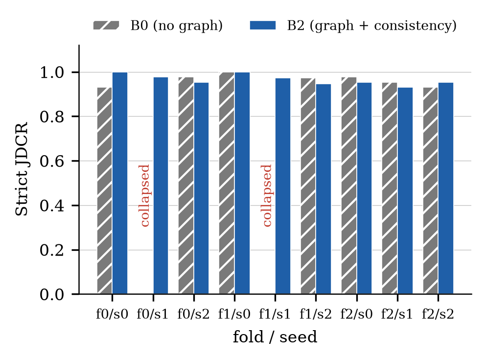
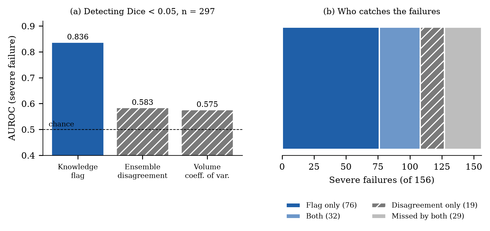

# KG-XAI: Knowledge-Graph-Guided Consistency for Stroke Infarct Segmentation

Ekanath D V · Rohan Julius Preetan — School of Computer Science and Engineering, Vellore Institute of Technology, Chennai

KG-XAI segments the final infarct from admission CT imaging of acute ischemic stroke, injects a patient-specific
Circle-of-Willis vessel graph and guideline knowledge into the segmentation network, checks every prediction against the
one clinical rule that held up in real data (the infarct must lie on the same side as the occluded vessel), and explains each
prediction. It is evaluated on held-out patients from the public ISLES'24 dataset, and every result, including the negative
ones, is reported.

## Highlights

- **Two-layer knowledge graph.** A 12-node Circle-of-Willis vessel graph built from each patient's own vessel mask, and a guideline
  graph of 16 concepts and 7 rules drawn from DAWN, DEFUSE-3 and the AHA/ASA guideline.
- **Rules are tested before they are used.** Each guideline rule was checked against ground truth in the target cohort; only one of
  seven holds (infarct side agrees with occlusion side in 94.7% of patients).
- **Graph-injected segmentation.** A graph attention network over the vessel graph feeds every decoder stage through
  zero-initialized cross-attention, so the model is identical to the plain baseline at the start of training.
- **Consistency metric.** The Joint-Decision Consistency Rate (JDCR) measures how often a model's own predictions agree with the
  patient's occlusion side.
- **Ground-truth-free failure detection.** A rule check built from the same graph flags predictions that are on the wrong side or
  implausibly small, and detects severe segmentation failure with AUROC 0.836.
- **Explainability.** Per-prediction channel-importance bars and heatmaps, a deterministic rationale, and a local-model assistant
  that answers questions only from numbers the system computed.

## Pipeline

```
 Admission CT (NCCT, CTA, CBF, CBV, MTT, Tmax) + Circle-of-Willis vessel mask + occlusion mask
                         |
            resample to 1 mm, normalise
                         |
        +----------------+-----------------+
        |                                  |
 lesion-centred patch               whole-brain view
 128 x 128 x 64                     (graph branch)
        |                                  |
        |                       12 vessel coordinates sampled from
        |                       encoder features (grid_sample)
        |                                  |
 shared SegResNet encoder          2-layer GAT over the vessel graph
        |                           -> 12 vessel embeddings
        |                                  |
 SegResNet decoder  <--- zero-initialised cross-attention, every stage
        |
 predicted infarct mask
        |
        +--> rule evaluator: laterality vs. occlusion side -> JDCR, trust flag, rationale
        +--> channel-occlusion explanation: importance bars + heatmap
        +--> local-model assistant: answers from the computed facts only
```

**Inputs.** Six admission imaging channels at 1 mm isotropic resolution: non-contrast CT, CT angiography, and four CT-perfusion
maps (cerebral blood flow, cerebral blood volume, mean transit time, Tmax). The segmentation target is the follow-up
(day 2–9) diffusion-weighted infarct. The follow-up scan is never a model input.

**Vessel graph.** Twelve nodes and twelve edges (ICA, MCA, ACA, PCA, Acom, Pcom, BA). Topology is fixed; anatomical variants are
represented as absent nodes with a per-patient presence flag. A vessel is marked occluded only if the occlusion mask lies within
15 mm of it.

**Loss (B2).** Dice + cross-entropy on the patch branch, plus a laterality term that penalises predicted lesion mass on the wrong
side of the per-patient midline (weight 0.1).

**Rule evaluator.** A prediction is *consistent* if under half of its lesion lies on the wrong side. JDCR is the share of
evaluable patients that are consistent; the strict version counts an empty prediction as a failure so a model cannot raise the
score by abstaining. The trust flag marks a prediction when its lesion is on the wrong side or smaller than 1 mL, using no
ground truth.

## Models compared

| Model | Description |
|---|---|
| **B0** | SegResNet baseline, no knowledge graph |
| **B1** | B0 + GAT over the vessel graph, injected by zero-initialized cross-attention |
| **B2** | B1 + laterality-consistency loss (full KG-XAI) |

All three share the same input, patch size, augmentation, warm-start trunk and data splits. Evaluation is a 3-fold × 3-seed grid
(B0 and B2: 9 runs each; B1: fold 0 × 3 seeds) with pass marks fixed before the runs.

## Results

Dataset: ISLES'24 public training release, 148 usable patients from 2 centers.

### Plausibility rules

| Rule | Result | Status |
|---|---|---|
| Infarct on the occluded side | 89/94 = 94.7% | Supported |
| Proximal occlusion implies larger infarct | medians 13.8 vs. 13.1 mL, p = 0.66 | Rejected |
| Good collaterals limit infarct size (HIR) | ρ = 0.05, p = 0.54 | Rejected |
| Poor collaterals imply larger infarct | p = 0.13 | Rejected |
| HIR behaves as a collateral signal | ρ = +0.19 (wrong sign) | Rejected |
| Infarct lies within the Tmax > 6 s region | median 0.51 (mark 0.70) | Rejected |
| Large infarct requires an occlusion | only 4 negative patients | Untestable |

Every patient in this release was successfully reperfused, which is the likely reason the size- and collateral-based rules do not
hold.

### Segmentation and consistency (full grid)

| | B0 (n = 9) | B1 (n = 3) | B2 (n = 9) |
|---|---|---|---|
| Final Dice | 0.191 (0.240 without collapsed runs) | 0.225 | **0.242** |
| Best Dice | 0.194 (0.243) | 0.248 | **0.257** |
| Lesion-wise F1 | 0.256 (0.323) | 0.263 | 0.292 |
| Strict JDCR | 0.749 (0.963) | 0.969 | 0.965 |
| Expected calibration error | 0.0263 (0.0169) | 0.0085 | 0.0097 |
| Collapsed runs | 2 / 9 | 0 / 3 | 0 / 9 |



- B2's mean JDCR is higher than B0's (0.965 vs. 0.749), but the gap comes from two B0 runs that collapsed to an empty prediction.
  Across all nine pairs the difference is not significant (Wilcoxon p = 0.40), and over the seven pairs where B0 trained normally the
  two are indistinguishable (p = 0.84).
- Dice does not differ significantly between B2 and B0 (per-patient paired test on seed 0, n = 148, p = 0.59; pooled over 345
  paired observations, p = 0.24).
- B2's measured advantages are robustness (no collapsed run in nine) and lower calibration error.

### The learned graph pathway does not improve accuracy

| Test (B1, fold 0, 3 seeds) | Result |
|---|---|
| Random same-size graph instead of the real anatomy | Dice 0.2263 vs. 0.2247 (real) |
| Cross-attention gate forced open from initialization | Dice change of −0.0007 |
| Second collateral measure from graph topology, against volume and admission NIHSS | null |
| Vessel-presence features vs. expert TopCoW annotation | 91.8% agreement; disagreement does not predict Dice |

### Ground-truth-free failure detection

Detecting severe failure (Dice < 0.05) on 297 subject-seed predictions:

| Signal | AUROC |
|---|---|
| **Knowledge-graph rule check** | **0.836** |
| Ensemble disagreement | 0.583 |
| Volume coefficient of variation | 0.575 |



Of 156 severe failures, the rule check alone catches 69.2%, ensemble disagreement alone 32.7%, and together 81.4%. All 76
failures caught only by the rule check are real failures. On a smaller single-model subset, MC-dropout volume variation is
competitive on subtler failures (AUROC 0.819), so the rule check's advantage is specific to catastrophic, structurally clear
failures.

### Auxiliary heads

LVO localization and a collateral-proxy head collapsed to a constant prediction under four training regimes. An admission-NIHSS
regression head, trained on a real and well-populated label, learned a genuine signal (Spearman ρ = 0.56–0.60 on held-out
patients, fold 0, three seeds), which points to label quality and data scale as the cause.

## Interactive demo

A local web app runs the trained models on the 50 held-out fold-0 patients and compares two side by side. Each panel shows
the prediction, the true lesion outline, the brain midline, Dice, the trust flag and the rationale. It adds:

- **Why this prediction?** — each scan channel is blanked in turn and the drop in the model's lesion confidence is shown as six
  bars, with a per-channel heatmap on the slice.
- **Triage assistant** — a local model (`gemma3:4b` through Ollama) answers questions using only numbered facts the system
  computed. Answers containing invented numbers, missing citations, advice wording or misattributed facts are rejected and
  replaced by a built-in summary.

```bash
ollama serve                                    # once, for the assistant (optional)
python -m demo.server --root /path/to/ISLES-2024/train --cache-dir /path/to/cache --warm-explain
# open http://127.0.0.1:8765
python -m demo.test_xai --live                  # 34 checks against the running demo
```

See [`demo/README.md`](demo/README.md) for details.

## Installation

```bash
python -m venv .venv
.venv/Scripts/activate                          # .venv/bin/activate on Linux/macOS
pip install -r requirements.txt
pip install torch --index-url https://download.pytorch.org/whl/cu128   # GPU build
```

A CUDA GPU is needed for training and the demo. The ISLES'24 data (about 100 GB) is not included; download it separately and pass
its path with `--root`.

## Usage

```bash
# knowledge graph and data audits (no GPU)
python -m src.graph.build
python -m src.graph.features         --root /path/to/ISLES-2024/train
python -m src.graph.constraint_support
python -m src.data.audit             --root /path/to/ISLES-2024/train

# train the baseline (B1 and B2 use train_graph_seg.py and train_graph_seg_consistency.py)
python -m src.model.train_baseline --root /path/to/ISLES-2024/train --fold 0 \
    --epochs 200 --val-interval 10 --cache-dir /path/to/cache --num-workers 4

# full 3-fold x 3-seed grid and aggregation
python -m src.model.run_phase8
python -m src.eval.phase8_aggregate

# regenerate the paper figures from the reported numbers
python paper/make_figures.py
```

## Repository layout

```
kg/                 knowledge graph: vessel graph and guideline graph (JSON)
src/graph/          graph validation, per-patient vessel features, constraint tests
src/data/           ISLES'24 audits
src/model/          data pipeline, B0/B1/B2 training, GAT head, consistency loss, NIHSS head
src/eval/           metrics, rule evaluator and JDCR, grid aggregation, failure-detection baselines
src/conformal/      calibration layer used by the rule evaluator
demo/               compare demo: server, page, explanations, assistant, tests
paper/              manuscript (conference and full versions), figures, make_figures.py
outputs/tables/     every reported number, as JSON
```

Model checkpoints (`outputs/checkpoints/`) are git-ignored and regenerated by the training scripts.

## Dataset

ISLES'24 public training release: 149 patients (148 usable) from two centers, with non-contrast CT, CT angiography, CT-perfusion
maps, a Circle-of-Willis segmentation, an admission occlusion mask, a follow-up diffusion-weighted infarct mask and clinical
data. It contains no timing data, ASPECTS score or collateral grade, so no time-window eligibility rule can be evaluated.

## Limitations

- One public dataset from two centers; no claim is made about generalization beyond it.
- Dice is modest (about 0.24 on average) and large infarcts are usually under-predicted.
- The learned graph pathway does not improve segmentation accuracy; the graph's measured value is as a rule check.
- The cause of the two baseline training collapses is not determined.
- The MC-dropout comparison covers a single model, fold and seed.
- Channel explanations describe what the model relied on, not the patient's physiology, and have not been formally validated for
  faithfulness.
- Research prototype, not a medical device.

## References

1. Luan T. et al. Unified multimodal learning for stroke triage: joint detection, scoring, and segmentation of acute ischemic
   stroke. *npj Digital Medicine* 9:441 (2026).
2. Riedel E. O. et al. The ISLES'24 dataset. *Radiology: Artificial Intelligence* 8(3) (2026). doi:10.1148/ryai.250603.
3. Myronenko A. 3D MRI brain tumor segmentation using autoencoder regularization. *MICCAI Brainlesion Workshop* (2018).
4. Veličković P. et al. Graph attention networks. *ICLR* (2018).
5. Yang K. et al. TopCoW: benchmarking topology-aware anatomical segmentation of the circle of Willis. arXiv:2312.17670 (2023).
6. Nogueira R. G. et al. Thrombectomy 6 to 24 hours after stroke with a mismatch between deficit and infarct (DAWN).
   *N. Engl. J. Med.* 378:11–21 (2018).
7. Albers G. W. et al. Thrombectomy for stroke at 6 to 16 hours with selection by perfusion imaging (DEFUSE 3).
   *N. Engl. J. Med.* 378:708–718 (2018).
8. Lakshminarayanan B. et al. Simple and scalable predictive uncertainty estimation using deep ensembles. *NeurIPS* (2017).
9. Gal Y., Ghahramani Z. Dropout as a Bayesian approximation. *ICML* (2016).

Sources behind the knowledge graph are listed in [`KNOWLEDGE_GRAPH_SOURCES.md`](KNOWLEDGE_GRAPH_SOURCES.md).
